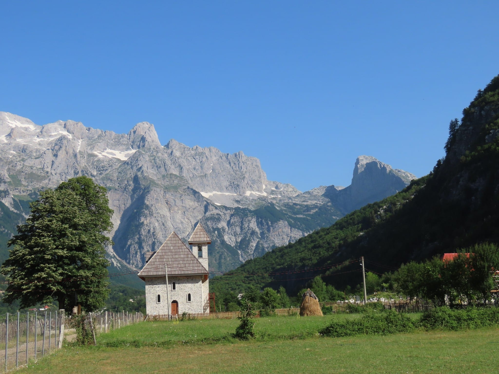
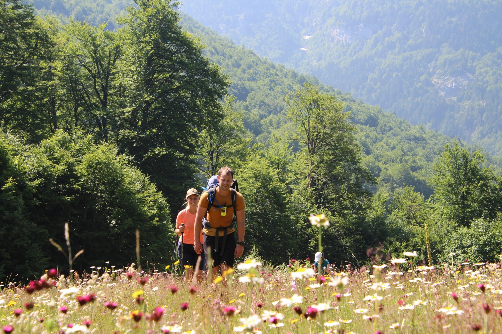
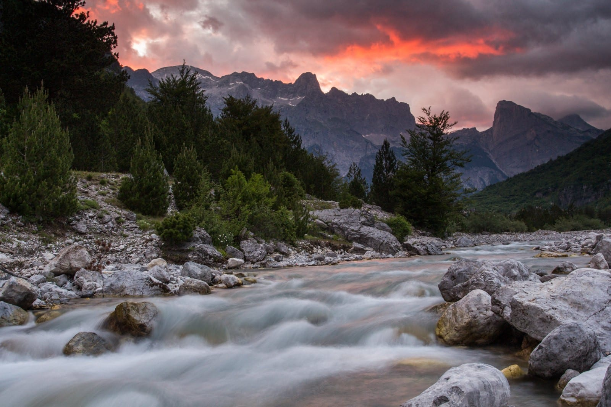

Der Juni ist der Saisonstart auf den Peaks of the Balkans. Die Tage sind die längsten des Jahres, die Täler sind grün und auf dem Weg ist es noch ruhig. Der Haken ist der Schnee: In den Verwunschenen Bergen fällt im Winter viel davon, und auf den hohen Pässen kann er bis weit in den Juni liegen bleiben. Ob der Juni für dich passt, hängt vom Jahr ab, davon, welche Monatshälfte du wählst, und von deiner Erfahrung im Schnee.

## Anfang Juni oder Ende Juni auf einen Blick

| | Anfang Juni | Ende Juni |
|---|---|---|
| Schnee auf hohen Pässen | Wahrscheinlich, manchmal viel; steile, harte Schneefelder an Nordhängen | Meist nur Reste; mehr in schneereichen Jahren |
| Theth – Valbonë | Sommerweg nach einem schneereichen Winter eventuell noch gesperrt; Winterroute als Alternative | Normalerweise offen |
| Wetter | Meist mild; in den Tälern etwa 20–25 °C, auf den Pässen kühler | Wärmer; Gewitter am Nachmittag werden häufiger |
| Tageslicht | Etwa 15 Stunden | Etwa 15 Stunden, die längsten Tage des Jahres |
| Flüsse und Quellen | Hoch und schnell durch Schmelzwasser | Noch reichlich Wasser |
| Andrang | Sehr ruhig | Ruhig, Richtung Juli voller |
| Fazit | Nur mit Schneeerfahrung, Ausrüstung und flexiblem Plan | In den meisten Jahren gut |

Temperaturen und Bedingungen schwanken stark von Jahr zu Jahr. Für die ganze Saison siehe [die beste Reisezeit für die Peaks of the Balkans](/de/best-time-peaks-of-the-balkans/).

## Schnee: Welche Pässe am längsten weiß bleiben

Der größte Teil der Runde verläuft zwischen etwa 1.700 und 2.300 m, und der Schnee hält sich am längsten an den steilen Nordseiten der Pässe. Lokale Veranstalter nennen den Übergang zwischen Vusanje und Theth (den Pejë-Pass) und den Valbona-Pass zwischen Theth und Valbonë als Stellen, an denen harte Schneefelder bis in den Juni überdauern; Wanderer am Saisonanfang mussten dort schon umkehren. Höhere Abstecher wie der Gipfel des Gjeravica und die Route über Zla Kolata halten den Schnee noch länger.

2026 hat gezeigt, wie groß der Unterschied sein kann. Nach einem harten Winter und einem kalten Frühling meldete ein lokaler Veranstalter am 27. Mai 2026 Schnee auf fast jeder Etappe; der klassische Weg Theth – Valbonë war noch gesperrt und die Winterroute die einzige sichere Option. Wanderer, die am 6. Juni 2026 starteten, beschrieben sehr viel Schnee auf den hohen Pässen und Gipfeln; selbst manche geführte Gruppen ließen ihre geplanten Gipfel aus. In einem normalen Jahr ist der Schnee auf den hohen Pässen dagegen bis Ende Juni weitgehend geschmolzen.

Schnee an diesen Hängen ist kein gemütlicher Spaziergang. Eine dünne, harte Schicht verdeckt den Weg, und ein Ausrutscher auf einem steilen Schneefeld kann in den Felsen enden. Grödel und Wanderstöcke machen einen großen Unterschied, ersetzen aber keine Schneeerfahrung. Hast du keine, wähle Ende Juni oder warte bis Juli.

## Die Etappe Theth – Valbonë im Juni

Das ist der bekannteste und meistbegangene Tag auf dem Weg, und auch der, der als letzter öffnet. Der Sommerweg über den Valbona-Pass (etwa 1.800 m) bleibt gesperrt, bis der Schnee vom Pass verschwunden ist; bis dahin nehmen Wanderer eine tiefere Winterroute oder einen Transfer. Frag am Abend vorher in deinem Gästehaus in Theth oder Valbonë, welche Route gerade genutzt wird. Siehe [die Wanderung von Theth nach Valbonë](/de/theth-to-valbona/) für die Route selbst.

## Warum sich der Juni trotzdem lohnt

Wenn der Schnee es zulässt, ist der Juni einer der schönsten Monate auf dem Weg. Die Hochwiesen sind frisch grün und voller Wildblumen, die Wasserfälle führen am meisten Wasser, und die Hirten ziehen auf die Sommerweiden. Außerdem hast du die längsten Tage des Jahres und damit viel Spielraum auf langen Etappen.

Es ist auch viel ruhiger als im Juli und August. Abseits von Theth – Valbonë kannst du stundenlang laufen, ohne jemandem zu begegnen, und Gästehäuser haben meist Platz, ohne dass du Monate im Voraus buchen musst.

## Flüsse, Wasser und Wetter

Durch das Schmelzwasser ist der Juni unter den Füßen ein nasser Monat. Bäche und Flüsse führen viel Wasser und fließen schnell, manche Querungen, die im August einfach sind, verlangen jetzt Vorsicht, und Wege können schlammig sein. Dafür sprudeln die Quellen und Wasser ist selten ein Problem, außer auf langen hohen Abschnitten, wo Schnee manchmal das einzige Wasser ist; nimm an diesen Tagen eine Flasche extra mit.

Das Wetter ist meist angenehm: Wanderer berichteten im Juni 2026 von etwa 20–25 °C in den Tälern und rund 10–18 °C auf den Pässen, klaren Morgen und mehr Wolken am Nachmittag. An Sommernachmittagen bauen sich über den Bergen Gewitter auf, also starte früh und sei möglichst am frühen Nachmittag über jeden Pass. Pack eine warme Schicht für windige Pässe und kalte, frühe Starts ein.

## Gästehäuser und Hütten im Juni

In den größeren Dörfern (Theth, Valbonë, Plav, Vusanje) haben die meisten Gästehäuser ab Juni geöffnet. Die hohen Sommersiedlungen sind saisonaler: Orte wie Dobërdol sind Hirtensiedlungen, die erst zum Leben erwachen, wenn die Herden hinaufziehen, und in einem späten Jahr öffnen sie vielleicht später oder haben weniger Betten. Eine offizielle Liste mit Öffnungsdaten gibt es nicht, also kontaktiere jedes Gästehaus direkt, vor allem für die erste Junihälfte. Siehe [wie Dobërdol ist und wo du dort schläfst](/de/dobrdol-plateau/).

## So planst du eine Tour im Juni

- **Wähle lieber die zweite Junihälfte,** vor allem nach einem schneereichen Winter.
- **Prüfe die Bedingungen eine Woche vor der Abreise:** Frag deine Gästehäuser, lokale Guides oder Veranstalter nach jedem Pass, und noch einmal am Abend vor jeder hohen Etappe.
- **Nimm Grödel und Stöcke mit,** und quere steilen Schnee nur, wenn du weißt, wie das geht.
- **Hab einen Plan B** für jeden hohen Pass: eine tiefere Route, einen Transfer oder einen Ruhetag.
- **Nutze einen GPS-Track,** denn Schnee verdeckt Markierungen und Wege. Siehe [die Packliste](/de/peaks-of-the-balkans-packing-list/) für den Rest deiner Ausrüstung.
- **Beantrage deine Genehmigungen rechtzeitig:** Grenzgenehmigungen brauchst du in jeder Saison. Siehe [den Ratgeber zu Genehmigungen](/de/peaks-of-the-balkans-permits/).

Wenn du das Prüfen von Pässen und Betten lieber anderen überlässt: [The Balkan Trail](https://thebalkantrail.com) kümmert sich um Genehmigungen und Transfers, sodass du in deinem eigenen Tempo wanderst, mit Guides entlang der Route, optionalem Gepäcktransport und Ausrüstungsverleih.

## Quellen

[Peaks of the Balkans – offizielle Website](https://peaksofthebalkans.com/), [BN Adventure – Update zu den Wegbedingungen, Ende Mai 2026](https://bnadventure.com/pob-trail-conditions-may-2026/), [Peaks of the Balkans App – wann ist die beste Zeit zum Wandern](https://peaksofthebalkans.app/articles/when-is-the-best-time-to-hike), [Brooke Beyond – Routen- und Planungsguide Peaks of the Balkans](https://brookebeyond.com/peaks-of-the-balkans), [Wander Balkans – wie sicher sind die Peaks of the Balkans?](https://wanderbalkans.com/peaks-of-the-balkans-safety/).
