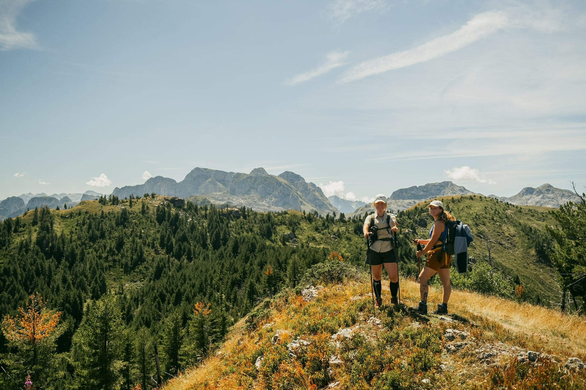
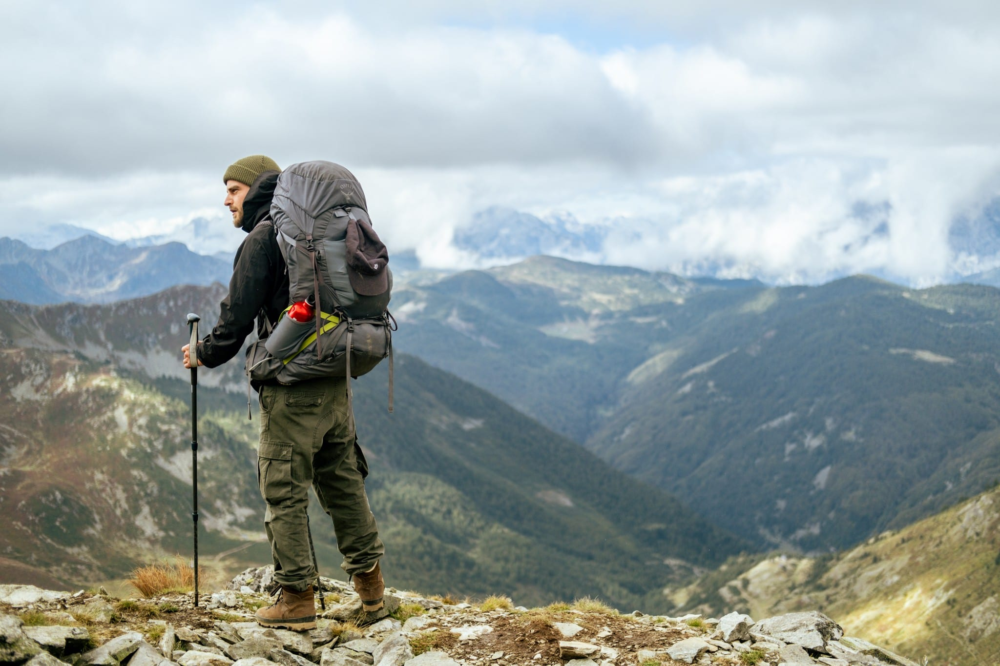
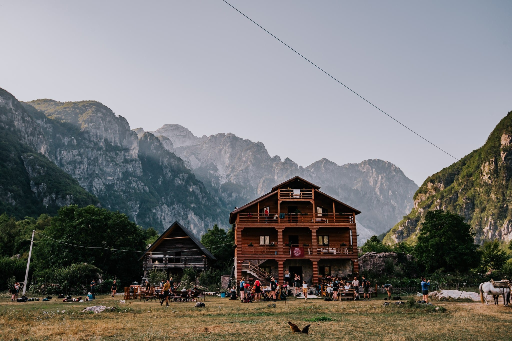

Der Herbst ist die ruhige Saison auf den Peaks of the Balkans. Die Organisatoren der Route empfehlen Juni bis Oktober, und viele Wanderer halten den September für den besten Monat überhaupt. Der Oktober ist noch machbar, aber du tauschst die Menschenmassen gegen kürzere Tage, kältere Nächte und eine echte Chance auf frühen Schnee auf den Pässen. Hier erfährst du, was sich zwischen den beiden Monaten ändert und wie du damit planst.

## September und Oktober im Überblick

| | September | Oktober |
|---|---|---|
| Wetter | Meist stabil, kühler als im Sommer, gegen Monatsende mehr Regen und Gewitter | Häufiger Regenphasen, kalte Nächte; erster Schnee auf den Pässen möglich |
| Temperaturen | Angenehme Tage; nachts kann es in der Höhe unter 0 °C fallen | In den Tälern an sonnigen Tagen noch etwa 20–25 °C; weiter oben deutlich kälter |
| Tageslicht | Etwa 13 Stunden zu Monatsbeginn, knapp unter 12 am Monatsende | Etwa 11,5 Stunden zu Monatsbeginn, etwa 10,5 am Monatsende; dunkel gegen 17:00 nach der Zeitumstellung |
| Unterkünfte | Praktisch alle noch geöffnet | Viele in der ersten Monatshälfte offen; saisonale Hütten und Cafés schließen |
| Andrang | Deutlich weniger Menschen als im Juli und August | Sehr ruhig, oft hast du den Weg für dich allein |
| Fazit | Ausgezeichnet | Möglich, am besten Anfang Oktober und mit flexiblem Plan |

Temperaturen und Tageslicht sind Richtwerte und schwanken stark von Jahr zu Jahr. Für das ganze Jahr siehe [die beste Zeit für die Peaks of the Balkans](/de/best-time-peaks-of-the-balkans/).

## September: der ideale Monat

Im September ist die Hitze von Juli und August vorbei, der Sommerandrang auf der Etappe Theth – Valbonë hat nachgelassen und alle Gästehäuser haben noch geöffnet. Erfahrene lokale Veranstalter beschreiben ihn als ruhiger, mit einer Natur, die sich zu verfärben beginnt: weniger Blumen, mehr Farbe. Die Fernsicht ist oft klarer als in den dunstigen Sommermonaten.

Es gibt aber auch Nachteile. Die Tage werden im Laufe des Monats spürbar kürzer, das Risiko für Regen und Gewitter steigt und nachts kann es in den hoch gelegenen Dörfern und Hütten frieren; manche Gästehäuser heizen schon. Plane lange Etappen mit einem Puffer an Tageslicht und nimm eine warme Schicht für die Abende mit. Auch Wasser ist im Herbst knapper: Quellen, Bäche und Wasserfälle wie Grunas in Theth führen viel weniger Wasser als im Frühsommer.

## Oktober: stille Wege, kurze Tage, erster Schnee

Der Oktober ist der letzte Monat, in dem du die ganze Runde gehen kannst, und selbst dann nicht in jedem Jahr. Dafür bekommst du leere Wege, Herbstfarben in den Buchenwäldern und an guten Tagen klare, frische Fernsicht. Eine Reisende, die im Oktober in Nordalbanien unterwegs war, berichtete von Tageshöchstwerten bis etwa 25 °C in den Tälern, rund 10 °C morgens und abends und nirgends Gedränge.

Dieselbe Reise zeigt auch das Risiko: In den ersten Oktobertagen fiel Schnee in den Bergen, selbst für die Einheimischen unerwartet, und die Wanderung über den Valbona-Pass musste verschoben werden. Veranstalter berichten außerdem von Oktobertouren, die nach mehreren Tagen Starkregen hintereinander abgesagt wurden. Ende Oktober geht die Sonne gegen 7:00 auf und vor 18:00 unter, auf einer langen Etappe bleibt also wenig Spielraum für Verzögerungen. Restaurants und Cafés in den Touristenorten schließen oder verkürzen ihre Öffnungszeiten.

## Gästehäuser, Hütten und Essen im Herbst

Die Route lebt von Familiengästehäusern und saisonalen Hütten, und genau das schränkt das Wandern im Herbst am meisten ein. In den Dörfern (Theth, Valbonë, Plav, Vusanje, Rugova) bleiben viele Gästehäuser bis in den Oktober oder länger geöffnet. Bei den hoch gelegenen Sommersiedlungen sieht es anders aus: Orte wie Dobërdol sind kleine Hirtensiedlungen mit sehr wenigen Betten, und sie schließen, wenn die Hirten die Berge verlassen. Mehr zu den Hütten auf der Hochebene findest du unter [wie Dobërdol ist und wo du dort schläfst](/de/dobrdol-plateau/).

Eine offizielle Liste mit Schließdaten gibt es nicht. Ruf deshalb Ende September und im Oktober ein paar Tage vorher bei jedem Gästehaus an oder schreib eine Nachricht, auch wenn du schon früher gebucht hast. Frag, ob es noch Abendessen und ein Lunchpaket gibt, denn die kleinen Cafés unterwegs haben oft schon zu; auf der Etappe Theth – Valbonë hat im Oktober manchmal nur eine der üblichen Einkehrmöglichkeiten geöffnet. Auch der öffentliche Verkehr wird nach dem Sommer dünner, also prüfe die Zeiten von Minibussen und Fähre vor Ort.

## Der Valbona-Pass und früher Schnee

Die höchsten und ausgesetztesten Etappen, darunter die Überquerung zwischen Theth und Valbonë über den Valbona-Pass (etwa 1.800 m) und die hohen Pässe rund um Dobërdol und den Gjeravica, sind als Erste von Schnee betroffen. Lokale Guides warnen, dass der Valbona-Pass nach frühem Schneefall gefährlich wird, und der kann schon ab Ende September kommen. Eine dünne Schneeschicht verdeckt den Weg und macht die steilen Abstiege rutschig.

Wenn Schnee fällt, warte ein oder zwei Tage, nimm einen Transfer um den Pass herum oder tausche die Etappe gegen eine tiefer gelegene Wanderung. Überquere einen verschneiten Pass nie ohne passende Ausrüstung und Erfahrung. Zur Route selbst siehe [die Wanderung von Theth nach Valbonë](/de/theth-to-valbona/).

## Tipps für eine Herbsttour

- **Früh in der Saison gehen:** Die erste Septemberhälfte ist die sicherste Wahl; im Oktober so früh im Monat wie möglich.
- **Beim ersten Licht starten:** Plane jede Etappe so, dass du lange vor Dunkelheit ankommst, mit einer Stunde Reserve.
- **Für Kälte packen:** eine warme Fleecejacke oder leichte Daunenjacke, Mütze, Handschuhe und eine richtige Regenjacke. Siehe [die Packliste](/de/peaks-of-the-balkans-packing-list/).
- **Vorher anrufen:** Bestätige jedes Bett, Abendessen und Lunchpaket ein paar Tage vor deiner Ankunft.
- **Einen Reservetag einplanen:** So kannst du eine Regenphase aussitzen oder warten, bis der Schnee auf einem Pass geschmolzen ist.
- **Jeden Abend den Wetterbericht prüfen** und deine Gastgeber nach der nächsten Etappe fragen; sie kennen die Pässe am besten.

Wenn du in der Nebensaison nicht selbst mit Buchungen und Transfers jonglieren willst, organisiert [The Balkan Trail](https://thebalkantrail.com) Genehmigungen und Transfers, sodass du in deinem eigenen Tempo mit Guides entlang der Route wanderst, optional mit Gepäcktransport und Ausrüstungsverleih.

## Quellen

[Peaks of the Balkans – offizielle Website, Reisehinweise](https://peaksofthebalkans.com/Travel-Advice), [Peaks of the Balkans Info – wann reisen](https://peaksofthebalkans.info/?p=533), [BN Adventure – umfassender Guide zu den Peaks of the Balkans](https://bnadventure.com/peaks-of-the-balkans-trail-comprehensive-guide/), [Shipped Away – Herbst in Albanien](https://shippedaway.com/autumn-in-albania/), [Brooke Beyond – Gästehäuser auf den Peaks of the Balkans](https://brookebeyond.com/pob-guesthouses).
