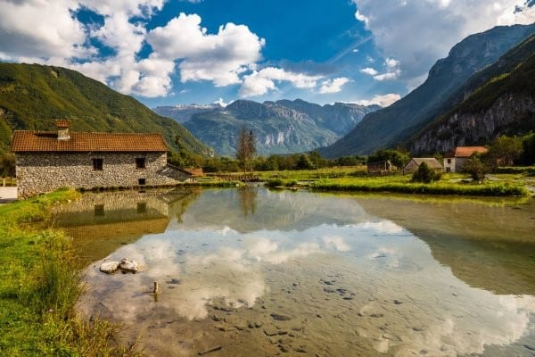
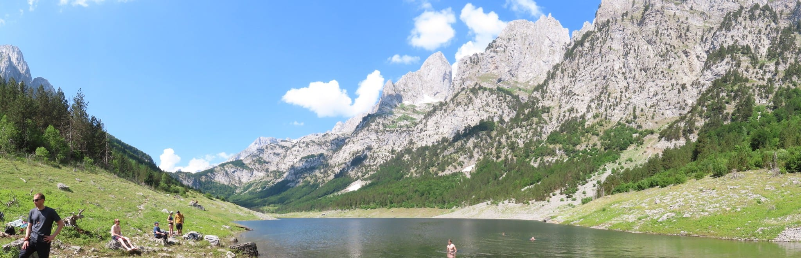
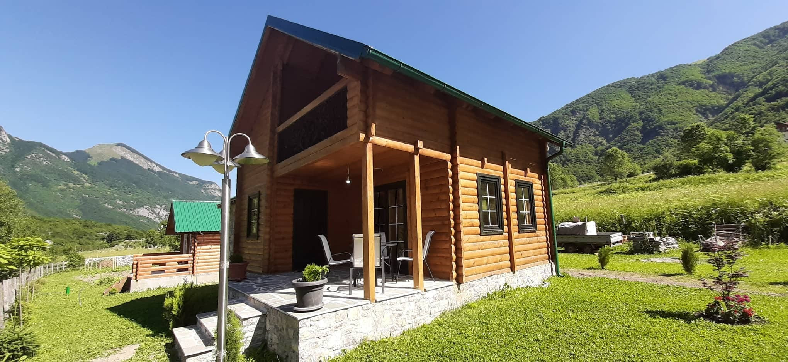

Vusanje, auf Albanisch Vuthaj, liegt ganz am Ende der Straße in Montenegros Prokletije-Gebirge, ein paar Kilometer hinter dem Städtchen Gusinje. Hinter dem Dorf zieht sich das Ropojana-Tal zwischen riesigen Kalkwänden nach Süden, Richtung albanische Grenze. Für Wanderer auf dem Peaks of the Balkans ist es die letzte Nacht in Montenegro vor dem Übergang nach Theth, und es lohnt sich, früh anzukommen: Die schönsten Orte liegen nur einen kurzen Spaziergang von deiner Unterkunft entfernt.

## Vusanje, Grlja und Ropojana auf einen Blick

| Sehenswürdigkeit | Was es ist | Ab Vusanje | Beste Zeit |
|---|---|---|---|
| Grlja-Wasserfall | Fluss, der in ein tiefes Felsloch stürzt | etwa 300 m hinter dem Dorf | Frühling und Frühsommer, wenn mehr Wasser fließt |
| Oko Skakavica | türkisfarbene Karstquelle, etwa 30 m breit | etwa 2,5 km talaufwärts vom Wasserfall | den ganzen Sommer |
| Ropojana-Tal | weites Gletschertal unter Kalkwänden | beginnt am Dorf | Juni bis September |
| Ropojana-See | saisonaler See auf etwa 1.240 m | tiefer im Tal, nahe der Grenzzone | Frühsommer, bevor er schrumpft |
| Ali-Pascha-Quellen | großes, flaches Quellbecken | etwa 1,4 km vom Zentrum von Gusinje | den ganzen Sommer |
| Qafa e Pejës | Pass auf der Etappe nach Theth, etwa 1.700 m | auf der Route des Peaks of the Balkans | Juli bis September |

Entfernungen und Höhen stammen aus lokalen Routenbeschreibungen und weichen je nach Quelle etwas ab, nimm sie also als Richtwerte.

## Vusanje: das Dorf am Ende der Straße

Vusanje ist ein weitläufiges Bauerndorf mit Häusern aus Stein und Holz, Wiesen und Heuhaufen, hinter dem die Kalkwände des Ropojana-Tals aufragen. Die Straße von Gusinje ist etwa 5 km lang; der Asphalt endet an einer Brücke kurz hinter dem Dorf, danach geht es als Schotterweg ins Tal. Es ist ein ruhiger Ort; die meisten Besucher sind Wanderer, Radfahrer und Tagesausflügler aus Gusinje und Plav.

Auf dem Peaks of the Balkans kommst du meist von Plav hierher und brichst am nächsten Morgen zu Fuß talaufwärts Richtung Albanien auf. Unter [alle Etappen Tag für Tag](/de/peaks-of-the-balkans-stages/) siehst du, wie Vusanje in die ganze Runde passt.

## Grlja: der Wasserfall, der im Fels verschwindet

Direkt hinter dem Dorf, ein paar hundert Meter hinter der Brücke, zweigt ein Pfad über eine Wiese zur Grlja (auch Grla geschrieben) ab. Hier stürzt der Fluss Skakavica, der aus dem Tal kommt, in einen riesigen Steinkessel von etwa 20 m Tiefe und scheint in einer dunklen Höhle zu verschwinden; der Legende nach ist sie bodenlos. Weiter unten tritt das Wasser wieder aus und fließt als Fluss Grlja weiter nach Gusinje.

Im Frühling und Frühsommer, zur Schneeschmelze, ist das Tosen beeindruckend. Ende Juli kann wenig Wasser fließen, aber hören kannst du es trotzdem. Es gibt keinen Zaun am Rand und die Felsen sind feucht, also halte Kinder nah bei dir und bleib weg von der Kante.

## Oko Skakavica: die Quelle oben im Tal

Etwa 2,5 km weiter talaufwärts, auf rund 1.000 m, entspringt die Skakavica am Oko Skakavice („das Auge der Skakavica“, manchmal auch Savino Oko genannt). Es ist eine der ergiebigsten Karstquellen des Prokletije: ein rundes, türkisfarbenes Becken von etwa 30 m Durchmesser, das aus mehreren Metern Tiefe aufsteigt, mit Wasser, das auch im Sommer bei etwa 5 °C bleibt. Ein kurzer, ausgeschilderter Waldpfad führt vom Talweg dorthin.

Das ist ein schöner Abendspaziergang am Tag deiner Ankunft in Vusanje oder eine erste Pause auf der Etappe nach Theth. Baden geht für Mutige, aber das Wasser ist eiskalt.

## Das Ropojana-Tal und der Ropojana-See

Südlich der Quelle öffnet sich das Ropojana-Tal: ein breites, flaches Gletschertal mit Buchenwald an den Hängen, hellen Schutthalden und grauen Kalkwänden von weit über 2.000 m auf beiden Seiten. Der Schotterweg folgt dem Talboden und wird oft von Frühjahrshochwassern beschädigt, rechne also mit holprigen Abschnitten. Der montenegrinische Teil des Nationalparks Prokletije beginnt an einem überdachten Rastplatz unterwegs.

Tiefer im Tal, etwa 15 Minuten durch Buchenwald von einer ausgeschilderten Abzweigung, liegt der Ropojana-See (Ropojansko jezero) auf etwa 1.240 m. Im Frühsommer kann er etwa 700 m lang und bis zu etwa 10 m tief sein, aber er wird von Schmelzwasser gespeist und schrumpft oder trocknet in den Sommermonaten oft aus. Der See liegt in der Grenzzone: Dahinter setzt sich das Tal nach Albanien fort, Richtung Zastan und zu den Seen von Bun i Jezercës. Ohne Grenzgenehmigungen ist der See der Ort zum Umkehren.

## Weiter geht's: von Vusanje nach Theth über den Qafa e Pejës

Auf dem Peaks of the Balkans wanderst du als ersten Teil der Etappe von Vusanje nach Theth durch das Ropojana-Tal. Nach dem Tal steigt der Weg zur Grenze an einer pyramidenförmigen Grenzmarke aus kommunistischer Zeit, führt nach Albanien und erreicht den Qafa e Pejës, den Peja-Pass auf etwa 1.700 m, bevor ein langer, steiler Abstieg ins Tal von Theth folgt.

| Vusanje → Theth | Werte (Quellen weichen ab) |
|---|---|
| Strecke | etwa 21–23 km |
| Aufstieg | etwa 1.100–1.140 m |
| Abstieg | etwa 1.140–1.440 m |
| Höchster Punkt | etwa 1.740 m |
| Gehzeit | etwa 7,5–9 Stunden |

Es ist ein langer Tag, also brich früh auf und nimm genug Wasser für den Aufstieg mit. Du überquerst die Grenze zwischen Montenegro und Albanien abseits jedes Grenzübergangs, deshalb brauchst du vorab Genehmigungen für beide Länder; siehe [den Ratgeber zu den Genehmigungen](/de/peaks-of-the-balkans-permits/). Bist du unten angekommen, erfährst du im [Theth-Ratgeber](/de/theth-guide/), was du dort unternehmen kannst.

## Übernachten und essen

Vusanje hat eine Handvoll Familien-Gästehäuser, Holzhütten und Campingplätze, einige direkt am Grlja-Wasserfall. Die meisten bieten Halbpension mit hausgemachtem Abendessen und Frühstück und können ein Lunchpaket für den Tag nach Theth vorbereiten. Die Preise liegen etwa im Rahmen des restlichen Trails; unter [wo du auf dem Peaks of the Balkans übernachtest](/de/peaks-of-the-balkans-accommodation/) findest du übliche Preise.

Buche für Juli und August im Voraus, denn dann sind die Betten in Vusanje schnell voll. Gusinje, etwa 5 km entfernt, bietet mehr Auswahl, Läden und Cafés. In den Gästehäusern kannst du selten mit Karte zahlen, komm also mit genug Bargeld an; in Plav gibt es Geldautomaten.

## Praktische Tipps

- **Bargeld:** Bezahlt wird in Euro. Nimm aus Plav genug für das Gästehaus und für Albanien am nächsten Tag mit.
- **Wasser:** Füll deine Flaschen an der Quelle Oko Skakavica auf oder frag in deiner Unterkunft; auf dem Aufstieg zum Qafa e Pejës gibt es nur wenige verlässliche Quellen.
- **Sicherheit an der Grlja:** Am Wasserfall gibt es kein Geländer und der Rand ist rutschig.
- **Grenzzone:** Geh ohne Genehmigungen nicht über den Ropojana-See hinaus nach Albanien.
- **Navigation:** Nimm eine Offline-Karte oder einen GPX-Track mit. Die Markierung ist rot-weiß, aber die Abschnitte durch Wald und Weiden können bei Nebel verwirrend sein.

Wenn du Genehmigungen, Unterkünfte und Transfers lieber nicht selbst organisieren willst, übernimmt [The Balkan Trail](https://thebalkantrail.com) das für dich, sodass du in deinem eigenen Tempo wanderst, mit Guides entlang der Route und auf Wunsch mit Gepäcktransport und Ausrüstungsverleih.

## Quellen

[Accursed Mountains – GU03 Ropojana Valley](https://accursed-mountains.me/?p=3948), [Accursed Mountains – GU04 Ali Pasha's Springs](https://accursed-mountains.me/?p=3950), [Peaks of the Balkans Info – Vusanje to Theth](https://peaksofthebalkans.info/?p=1826), [Peaks of the Balkans Info – Vusanje–Theth route description](https://peaksofthebalkans.info/?p=290), [Peaks of the Balkans Info – Vuthaj, Zastan and Bun i Jezercës](https://peaksofthebalkans.info/trail/stage/), [Gigaplaces – Oko Skakavice](https://www.gigaplaces.com/en/article-oko-skakavice/), [Shoes Your Path – Peaks of the Balkans from Vusanje to Theth](https://shoesyourpath.com/peaks-of-the-balkans-from-vusanje-to-theth/), [Peaks of the Balkans – official site](https://peaksofthebalkans.com/).
