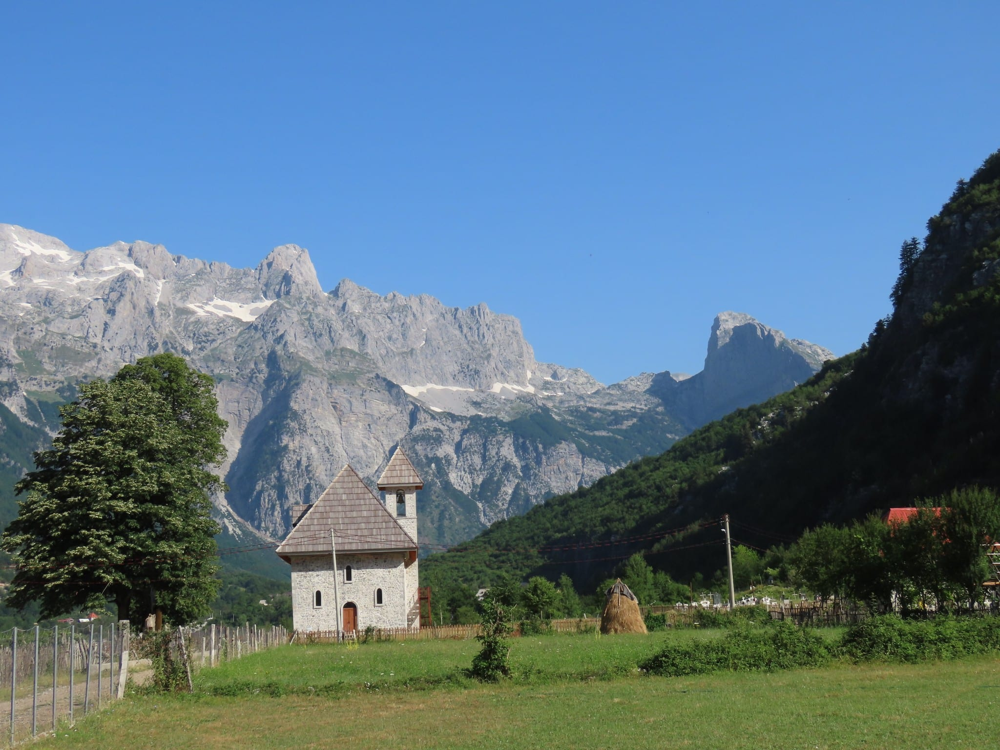
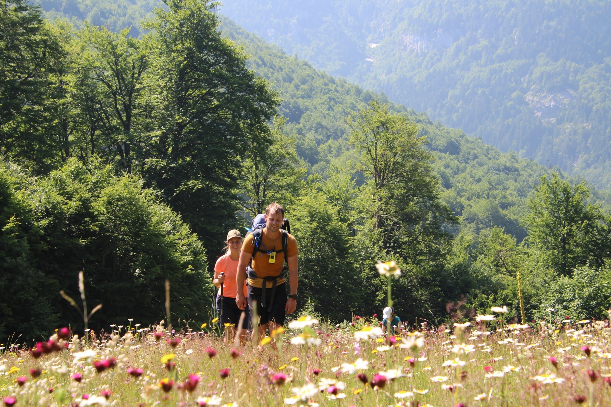
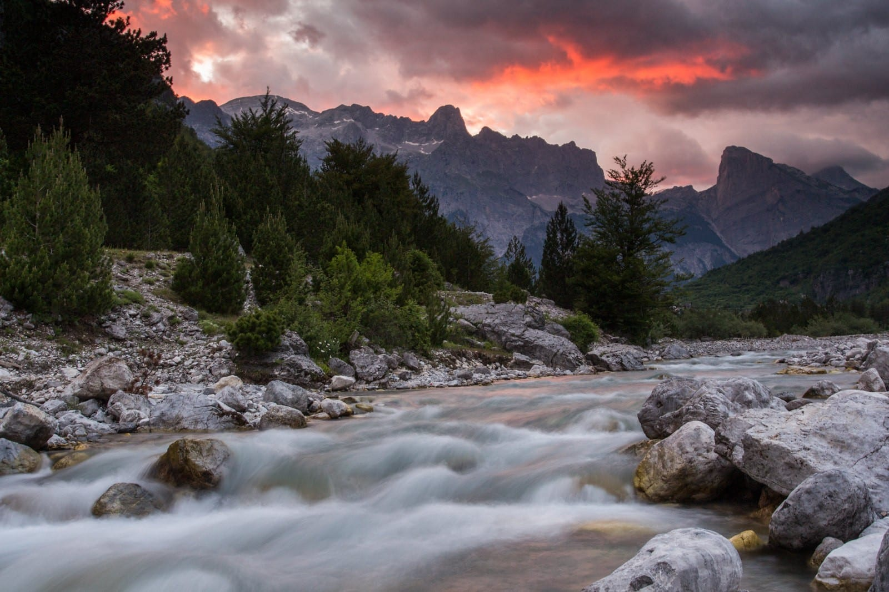

June is the start of the season on the Peaks of the Balkans. The days are the longest of the year, the valleys are green and the trail is still quiet. The catch is snow: the Accursed Mountains collect a lot of it in winter, and on the high passes it can last well into June. Whether June works for you depends on the year, on which half of the month you pick, and on your experience on snow.

## Early June vs late June at a glance

| | Early June | Late June |
|---|---|---|
| Snow on high passes | Likely, sometimes a lot; steep, hard snowfields on north-facing slopes | Usually only patches; more in heavy-snow years |
| Theth – Valbonë | Summer path may still be closed after a snowy winter; winter route as fallback | Normally open |
| Weather | Mostly mild; valleys about 20–25 °C, high passes cooler | Warmer; afternoon thunderstorms become more common |
| Daylight | About 15 hours | About 15 hours, the longest days of the year |
| Rivers and springs | High and fast with meltwater | Still plenty of water |
| Crowds | Very quiet | Quiet, busier towards July |
| Verdict | Only with snow experience, gear and a flexible plan | Good in most years |

Temperatures and conditions vary a lot from year to year. For the whole season, see [the best time to hike the Peaks of the Balkans](/en/best-time-peaks-of-the-balkans/).

## Snow: which passes stay white longest

Most of the loop runs between about 1,700 and 2,300 m, and the snow lies longest on the steep north sides of the passes. Local operators name the crossings between Vusanje and Theth (Pejë pass) and the Valbona pass between Theth and Valbonë as the places where hard snowfields survive into June, and early-season walkers have been turned back there. Higher detours such as the Gjeravica summit and the Zla Kolata route hold snow even longer.

2026 showed how big the difference can be. After a heavy winter and a cold spring, a local operator's update from 27 May 2026 reported snow on almost every stage, with the classic Theth – Valbonë path still closed and the winter route as the only safe option. Hikers who started on 6 June 2026 described a very large amount of snow on the high passes and summits; even some guided groups skipped their planned summits. In a normal year, by contrast, the snow has largely melted from the high passes by the end of June.

Snow on these slopes is not a gentle walk. A thin, hard layer hides the path, and a slip on a steep snowfield can end in rocks. Microspikes and trekking poles make a big difference, but they do not replace experience on snow. If you have none, choose late June or wait for July.

## The Theth – Valbonë stage in June

This is the most famous and busiest day on the trail, and also the one that opens last. The summer path over the Valbona pass (about 1,800 m) stays closed until the snow has gone from the pass; until then, hikers use a lower winter route or take a transfer. Ask your guesthouse in Theth or Valbonë the evening before which route is in use. See [the Theth to Valbonë hike](/en/theth-to-valbona/) for the route itself.

## Why June is still worth it

If the snow allows it, June is one of the most beautiful months on the trail. The high meadows are fresh green and full of wildflowers, the waterfalls are at their fullest, and the shepherds are moving up to the summer pastures. You also have the longest days of the year, which gives you plenty of margin on long stages.

The trail is also much quieter than in July and August. Away from Theth – Valbonë you can walk for hours without meeting anyone, and guesthouses usually have beds without booking months ahead.

## Rivers, water and weather

Meltwater makes June a wet month underfoot. Streams and rivers run high and fast, some crossings that are easy in August need care, and paths can be muddy. On the other hand, springs are flowing and water is rarely a problem, except on long high sections where the only water may be snow; carry an extra bottle on those days.

The weather is usually pleasant: hikers in June 2026 reported about 20–25 °C in the valleys and roughly 10–18 °C on the passes, clear mornings and more cloud in the afternoon. Thunderstorms build over the mountains on summer afternoons, so start early and aim to be over each pass by early afternoon. Pack a warm layer for windy passes and cold early starts.

## Guesthouses and huts in June

In the main villages (Theth, Valbonë, Plav, Vusanje) most guesthouses are open from June. The high summer settlements are more seasonal: places like Dobërdol are shepherd settlements that come alive when the herds move up, and in a late year they may open later or have fewer beds. There is no official list of opening dates, so contact every guesthouse directly, especially for the first half of June. See [what Dobërdol is like and where you sleep there](/en/dobrdol-plateau/).

## How to plan a June trip

- **Prefer the second half of June,** above all after a snowy winter.
- **Check conditions a week before you leave:** ask your guesthouses, local guides or operators about each pass, and again the evening before every high stage.
- **Bring microspikes and poles,** and only cross steep snow if you know how to.
- **Have a plan B** for every high pass: a lower route, a transfer or a rest day.
- **Use a GPS track,** because snow covers waymarks and paths. See [the packing list](/en/peaks-of-the-balkans-packing-list/) for the rest of your gear.
- **Arrange permits early:** border permits are needed for every season. See [the permits guide](/en/peaks-of-the-balkans-permits/).

If you would rather leave the checking of passes and beds to someone else, [The Balkan Trail](https://thebalkantrail.com) arranges permits and transfers, so you can walk at your own pace with guides along the route, with optional luggage transport and gear rental.

## Sources

[Peaks of the Balkans – official site](https://peaksofthebalkans.com/), [BN Adventure – trail conditions update, late May 2026](https://bnadventure.com/pob-trail-conditions-may-2026/), [Peaks of the Balkans App – when is the best time to hike](https://peaksofthebalkans.app/articles/when-is-the-best-time-to-hike), [Brooke Beyond – Peaks of the Balkans route and planning guide](https://brookebeyond.com/peaks-of-the-balkans), [Wander Balkans – is the Peaks of the Balkans safe?](https://wanderbalkans.com/peaks-of-the-balkans-safety/).
