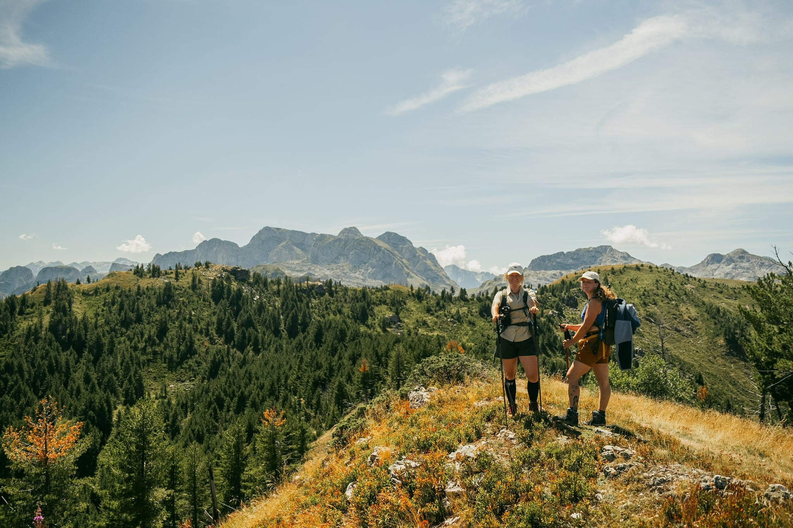
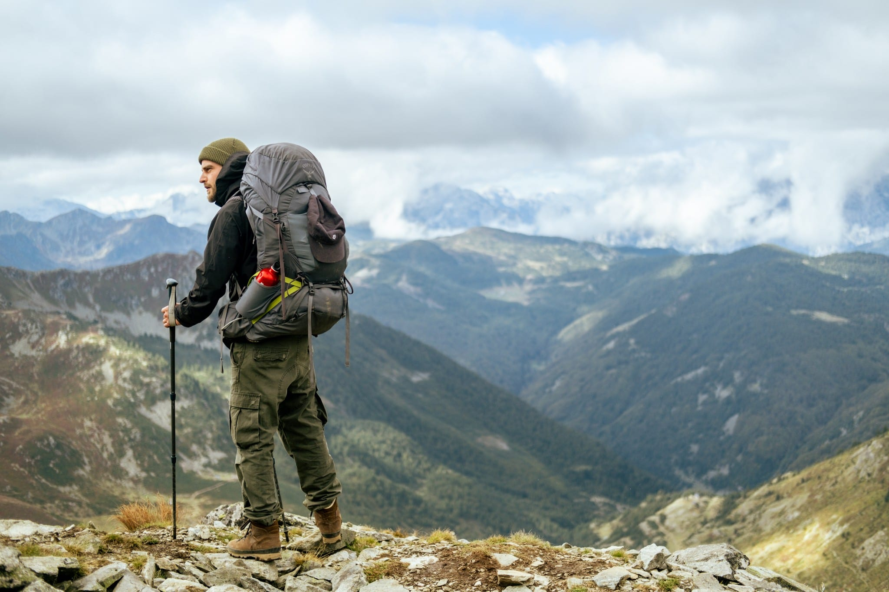
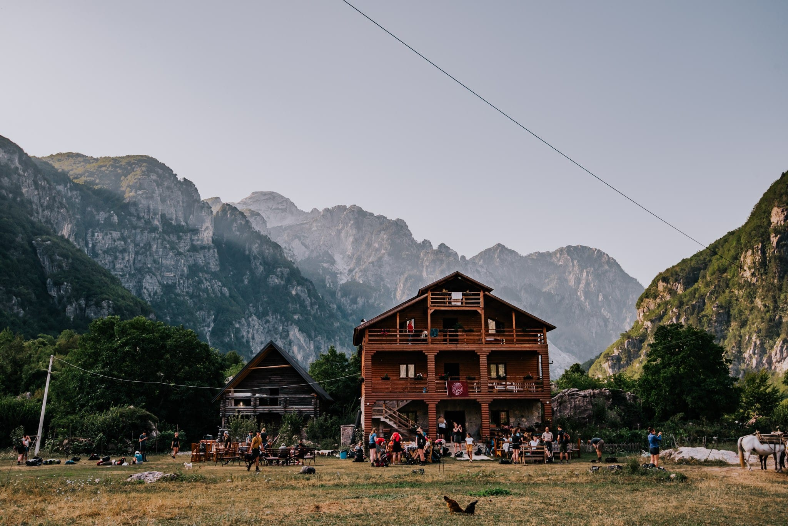

Autumn is the quiet season on the Peaks of the Balkans. The trail organisers recommend June to October, and many hikers rate September as the best month of all. October is still walkable, but you trade crowds for shorter days, colder nights and a real chance of early snow on the passes. Here is what changes between the two months, and how to plan around it.

## September vs October at a glance

| | September | October |
|---|---|---|
| Weather | Mostly stable, cooler than summer, more rain and thunderstorms towards the end of the month | More rain spells, cold nights; first snow on the passes is possible |
| Temperatures | Pleasant days; nights at altitude can drop below 0 °C | Valleys can still reach about 20–25 °C on sunny days; high up it is much colder |
| Daylight | About 13 hours at the start, just under 12 at the end | About 11.5 hours at the start, about 10.5 at the end; dark around 17:00 once the clocks go back |
| Guesthouses | Practically all still open | Many open in the first half; seasonal huts and cafés close |
| Crowds | Clearly fewer people than in July and August | Very quiet, often the trail to yourself |
| Verdict | Excellent | Possible, best in early October and with a flexible plan |

Temperatures and daylight are approximate and vary a lot from year to year. For the full year, see [the best time to hike the Peaks of the Balkans](/en/best-time-peaks-of-the-balkans/).

## September: the sweet spot

In September the heat of July and August is gone, the summer crowds on the Theth – Valbonë stage have thinned out, and the guesthouses are all still open. Long-standing local operators describe it as less busy, with nature starting to turn: fewer flowers, more colour. Views are often clearer than in the hazy summer months.

There are downsides. Days get noticeably shorter through the month, the risk of rain and thunderstorms grows, and nights in the high villages and huts can fall below freezing; some guesthouses already put the heating on. Plan long stages with a margin of daylight, and pack a warm layer for the evenings. Water is also lower in autumn: springs, streams and waterfalls such as Grunas in Theth carry much less water than in early summer.

## October: quiet trails, shorter days, first snow

October is the last month in which you can walk the full loop, and even then not every year. You get empty trails, autumn colours in the beech forests and, on a good day, crisp, clear views. One hiker who visited northern Albania in October reported daytime highs of up to about 25 °C in the valleys, around 10 °C in the mornings and evenings, and no crowds anywhere.

The same trip shows the risk: snow fell on the mountains in the first days of October, unexpected even for locals, and the hike over the Valbona pass had to be postponed. Operators also report October tours being cancelled after several days of heavy rain in a row. By the end of October the sun rises around 7:00 and sets before 18:00, so a long stage leaves little room for delays. Restaurants and cafés in the tourist centres start closing or shorten their hours.

## Guesthouses, huts and food in autumn

The trail runs on family guesthouses and seasonal huts, and that is what limits autumn hiking most. In the villages (Theth, Valbonë, Plav, Vusanje, Rugova) many guesthouses stay open into October or longer. The high summer settlements are a different story: places like Dobërdol are small shepherd settlements with very few beds, and they close when the herders leave the mountains. See [what Dobërdol is like and where you sleep there](/en/dobrdol-plateau/) for more on the plateau huts.

There is no official list of closing dates, so in late September and October call or message every guesthouse a few days ahead, even if you booked earlier. Ask whether they still serve dinner and can make a packed lunch, because the small cafés along the way are often already shut; on the Theth – Valbonë stage in October, sometimes only one of the usual refreshment stops is open. Public transport also thins out after the summer, so check minibus and ferry times locally.

## The Valbona pass and early snow

The highest and most exposed stages, including the crossing between Theth and Valbonë over the Valbona pass (about 1,800 m) and the high passes around Dobërdol and Gjeravica, are the first to be affected by snow. Local guides warn that the Valbona pass becomes dangerous after early snowfall, which can come from late September. A thin layer of snow hides the path and makes the steep descents slippery.

If snow falls, wait a day or two, take a transfer around the pass, or swap the stage for a lower walk. Never cross a snowed-in pass without the right gear and experience. See [the Theth to Valbonë hike](/en/theth-to-valbona/) for the route itself.

## Planning tips for an autumn trip

- **Go early:** the first half of September is the safest bet; in October, start as early in the month as you can.
- **Start at first light:** plan every stage so you arrive well before dark, with a reserve hour.
- **Pack for cold:** a warm fleece or light down jacket, hat, gloves and a proper rain jacket. See [the packing list](/en/peaks-of-the-balkans-packing-list/).
- **Call ahead:** confirm every bed, dinner and packed lunch a few days before you arrive.
- **Build in a spare day:** it lets you sit out a rain spell or wait for snow to melt off a pass.
- **Check the forecast every evening** and ask your hosts about the next stage; they know the passes best.

If you would rather not juggle bookings and transfers in the shoulder season, [The Balkan Trail](https://thebalkantrail.com) arranges permits and transfers, so you can walk at your own pace with guides along the route, with optional luggage transport and gear rental.

## Sources

[Peaks of the Balkans – official site, travel advice](https://peaksofthebalkans.com/Travel-Advice), [Peaks of the Balkans Info – when to go](https://peaksofthebalkans.info/?p=533), [BN Adventure – Peaks of the Balkans comprehensive guide](https://bnadventure.com/peaks-of-the-balkans-trail-comprehensive-guide/), [Shipped Away – autumn in Albania](https://shippedaway.com/autumn-in-albania/), [Brooke Beyond – Peaks of the Balkans guesthouses](https://brookebeyond.com/pob-guesthouses).
