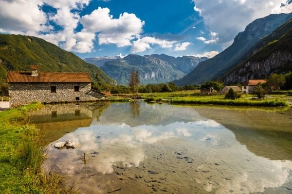
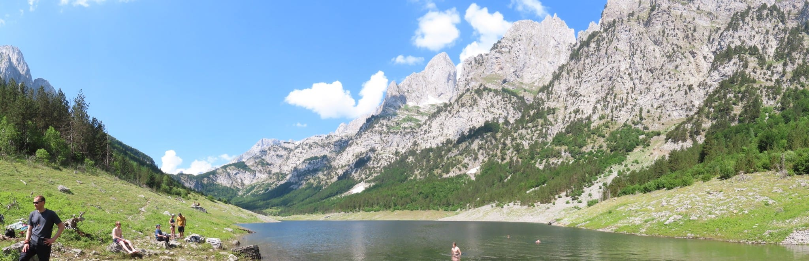
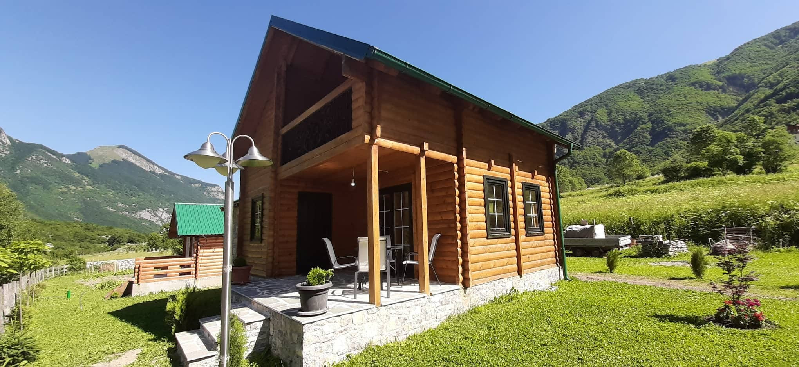

Vusanje, called Vuthaj in Albanian, sits at the very end of the road in Montenegro's Prokletije mountains, a few kilometres beyond the small town of Gusinje. Behind the village the Ropojana valley runs south between huge limestone walls towards the Albanian border. For Peaks of the Balkans hikers it is the last night in Montenegro before the crossing to Theth, and it is worth arriving early: the best sights are within an easy walk of your guesthouse.

## Vusanje, Grlja and Ropojana at a glance

| Sight | What it is | From Vusanje | Best time |
|---|---|---|---|
| Grlja waterfall | river plunging into a deep rock hole | about 300 m behind the village | spring and early summer, when there is more water |
| Oko Skakavica | turquoise karst spring, about 30 m across | about 2.5 km up the valley from the waterfall | all summer |
| Ropojana valley | wide glacial valley under limestone walls | starts at the village | June to September |
| Lake Ropojana | seasonal lake at about 1,240 m | deeper in the valley, near the border zone | early summer, before it shrinks |
| Ali Pasha Springs | large shallow spring pool | about 1.4 km from Gusinje centre | all summer |
| Qafa e Pejës | pass on the stage to Theth, about 1,700 m | on the Peaks of the Balkans route | July to September |

Distances and heights come from local route descriptions and differ a little between sources, so treat them as approximate.

## Vusanje: the village at the end of the road

Vusanje is a spread-out farming village of stone and wooden houses, meadows and haystacks, with the limestone walls of the Ropojana valley rising behind it. The road from Gusinje is about 5 km long; the asphalt ends at a bridge just past the village and continues as a gravel track up the valley. It is a quiet place; most visitors are hikers, cyclists and day-trippers from Gusinje and Plav.

On the Peaks of the Balkans you usually arrive here from Plav, and you leave the next morning on foot up the valley towards Albania. See [all stages day by day](/en/peaks-of-the-balkans-stages/) for how Vusanje fits the full loop.

## Grlja: the waterfall that disappears into the rock

Just behind the village, a few hundred metres past the bridge, a path forks through a meadow to Grlja (also written Grla). Here the Skakavica river, coming down from the valley, drops into a huge stone pot about 20 m deep and seems to vanish into a dark cave; local stories say it is bottomless. The water re-emerges below and continues as the Grlja river towards Gusinje.

In spring and early summer, when the snow melts, the roar is impressive. By late July there can be little water, but you still hear it. There is no fence around the edge and the rocks are damp, so keep children close and stay back from the rim.

## Oko Skakavica: the spring at the head of the valley

About 2.5 km further up the valley, at roughly 1,000 m, the Skakavica river is born at Oko Skakavice (\"the eye of Skakavica\", sometimes called Savino Oko). It is one of the most abundant karst springs in Prokletije: a round, turquoise pool about 30 m across, rising from several metres deep, with water that stays around 5 °C even in summer. A short, signposted forest path leads to it from the valley track.

It makes a lovely walk on the evening you arrive in Vusanje, or a first break on the stage to Theth. Swimming is possible for the brave, but the water is very cold.

## The Ropojana valley and Lake Ropojana

South of the spring the Ropojana valley opens up: a broad, flat glacial valley with beech forest on the slopes, pale scree, and grey limestone walls of well over 2,000 m on both sides. The gravel track follows the valley floor and is often damaged by spring floods, so expect rough sections. The Montenegrin part of Prokletije National Park begins at a roofed rest stop along the way.

Deeper in the valley, about 15 minutes from a signposted junction through beech forest, lies Lake Ropojana (Ropojansko jezero) at about 1,240 m. In early summer it can be around 700 m long and up to about 10 m deep, but it is fed by snowmelt and often shrinks or dries up in the summer months. The lake lies in the border zone: beyond it the valley continues into Albania towards Zastan and the lakes of Bun i Jezercës. Without border permits, the lake is the place to turn around.

## Walking on: Vusanje to Theth over Qafa e Pejës

On the Peaks of the Balkans you walk up the Ropojana valley as the first part of the stage from Vusanje to Theth. After the valley the trail climbs to the border at a communist-era pyramid marker, crosses into Albania and reaches Qafa e Pejës, the Peja pass at about 1,700 m, before a long, steep descent into the Theth valley.

| Vusanje → Theth | Figures (sources differ) |
|---|---|
| Distance | about 21–23 km |
| Climb | about 1,100–1,140 m |
| Descent | about 1,140–1,440 m |
| Highest point | about 1,740 m |
| Walking time | about 7.5–9 hours |

It is a long day, so start early and carry enough water for the climb. You cross the Montenegro–Albania border away from any checkpoint, so you need permits for both countries in advance; see [the permits guide](/en/peaks-of-the-balkans-permits/). Once you are down, [the Theth guide](/en/theth-guide/) tells you what to do there.

## Where to sleep and eat

Vusanje has a handful of family guesthouses, wooden cabins and campsites, some of them right by the Grlja waterfall. Most offer half board with home-cooked dinner and breakfast, and can make a packed lunch for the day to Theth. Prices are roughly in line with the rest of the trail; see [where you sleep on the Peaks of the Balkans](/en/peaks-of-the-balkans-accommodation/) for typical rates.

Book ahead for July and August, when beds in Vusanje fill up quickly. Gusinje, about 5 km away, has more choice, shops and cafés. Cards are rarely accepted in the guesthouses, so arrive with enough cash; Plav has ATMs.

## Practical tips

- **Cash:** pay in euros. Bring enough from Plav for the guesthouse and for Albania the next day.
- **Water:** fill up at the Oko Skakavica spring or ask your guesthouse; there are few reliable springs on the climb to Qafa e Pejës.
- **Safety at Grlja:** there is no railing at the waterfall and the edge is slippery.
- **Border zone:** don't walk beyond Lake Ropojana into Albania without permits.
- **Navigation:** carry an offline map or GPX track. Waymarks are red and white, but the forest and pasture sections can be confusing in fog.

If you would rather not sort out permits, guesthouses and transfers yourself, [The Balkan Trail](https://thebalkantrail.com) arranges them, so you can walk at your own pace with guides along the route, with optional luggage transport and gear rental.

## Sources

[Accursed Mountains – GU03 Ropojana Valley](https://accursed-mountains.me/?p=3948), [Accursed Mountains – GU04 Ali Pasha's Springs](https://accursed-mountains.me/?p=3950), [Peaks of the Balkans Info – Vusanje to Theth](https://peaksofthebalkans.info/?p=1826), [Peaks of the Balkans Info – Vusanje–Theth route description](https://peaksofthebalkans.info/?p=290), [Peaks of the Balkans Info – Vuthaj, Zastan and Bun i Jezercës](https://peaksofthebalkans.info/trail/stage/), [Gigaplaces – Oko Skakavice](https://www.gigaplaces.com/en/article-oko-skakavice/), [Shoes Your Path – Peaks of the Balkans from Vusanje to Theth](https://shoesyourpath.com/peaks-of-the-balkans-from-vusanje-to-theth/), [Peaks of the Balkans – official site](https://peaksofthebalkans.com/).
