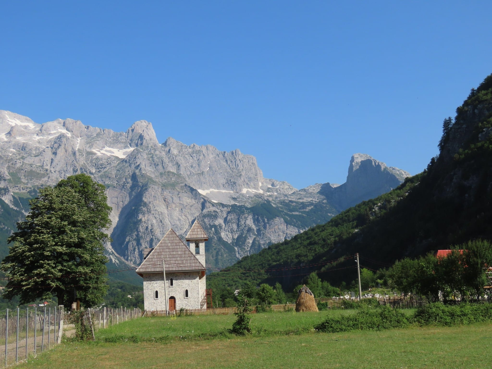
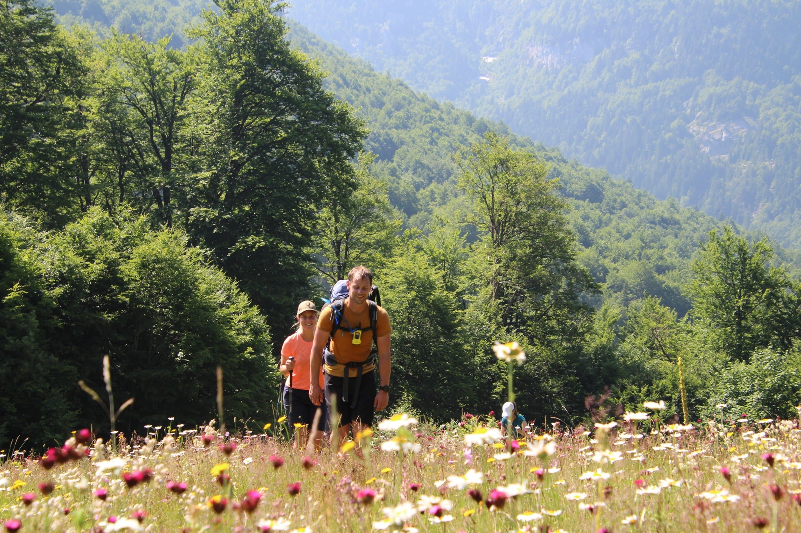
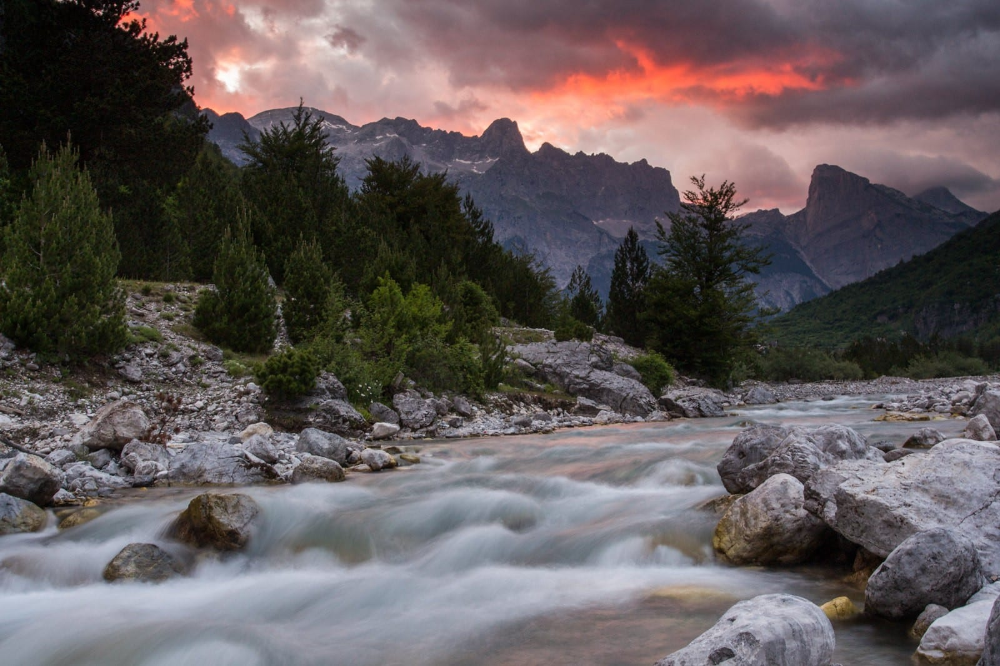

Juin marque le début de la saison sur les Peaks of the Balkans. Les journées sont les plus longues de l'année, les vallées sont vertes et le sentier est encore calme. Le hic, c'est la neige : les Montagnes maudites en reçoivent beaucoup en hiver, et sur les hauts cols elle peut rester jusque tard en juin. Que juin vous convienne ou non dépend de l'année, de la moitié du mois que vous choisissez et de votre expérience sur neige.

## Début juin ou fin juin : l'essentiel

| | Début juin | Fin juin |
|---|---|---|
| Neige sur les hauts cols | Probable, parfois abondante ; névés raides et durs sur les versants nord | Généralement quelques plaques ; davantage les années très enneigées |
| Theth – Valbonë | Le sentier d'été peut encore être fermé après un hiver neigeux ; itinéraire d'hiver en alternative | Normalement ouvert |
| Météo | Plutôt douce ; environ 20–25 °C dans les vallées, plus frais sur les cols | Plus chaud ; orages d'après-midi plus fréquents |
| Ensoleillement | Environ 15 heures | Environ 15 heures, les plus longues journées de l'année |
| Rivières et sources | Hautes et rapides avec la fonte des neiges | Encore beaucoup d'eau |
| Fréquentation | Très calme | Calme, plus de monde vers juillet |
| Verdict | Seulement avec expérience de la neige, équipement et plan souple | Bien la plupart des années |

Les températures et les conditions varient beaucoup d'une année à l'autre. Pour toute la saison, voir [la meilleure période pour randonner sur les Peaks of the Balkans](/fr/best-time-peaks-of-the-balkans/).

## La neige : quels cols restent blancs le plus longtemps

La majeure partie de la boucle se situe entre environ 1 700 et 2 300 m, et la neige persiste surtout sur les versants nord, raides, des cols. Les agences locales citent la traversée entre Vusanje et Theth (le col de Pejë) et le col de Valbona entre Theth et Valbonë comme les endroits où des névés durs subsistent jusqu'en juin ; des randonneurs en début de saison ont déjà dû faire demi-tour. Les variantes plus hautes, comme le sommet du Gjeravica et l'itinéraire par Zla Kolata, gardent la neige encore plus longtemps.

2026 a montré à quel point l'écart peut être grand. Après un hiver rigoureux et un printemps froid, le point d'une agence locale du 27 mai 2026 signalait de la neige sur presque toutes les étapes, le sentier classique Theth – Valbonë étant encore fermé et l'itinéraire d'hiver la seule option sûre. Des randonneurs partis le 6 juin 2026 ont décrit une très grande quantité de neige sur les hauts cols et les sommets ; même certains groupes guidés ont renoncé aux sommets prévus. Une année normale, en revanche, la neige a en grande partie fondu sur les hauts cols fin juin.

La neige sur ces pentes n'est pas une promenade. Une fine couche dure cache le sentier, et une glissade sur un névé raide peut se terminer dans les rochers. Microcrampons et bâtons font une grande différence, mais ne remplacent pas l'expérience de la neige. Si vous n'en avez pas, choisissez la fin juin ou attendez juillet.

## L'étape Theth – Valbonë en juin

C'est la journée la plus célèbre et la plus fréquentée du sentier, et aussi celle qui ouvre en dernier. Le sentier d'été par le col de Valbona (environ 1 800 m) reste fermé tant que la neige n'a pas disparu du col ; d'ici là, les randonneurs empruntent un itinéraire d'hiver plus bas ou prennent un transfert. La veille, demandez à votre maison d'hôtes à Theth ou à Valbonë quel itinéraire est utilisé. Voir [la randonnée de Theth à Valbonë](/fr/theth-to-valbona/) pour l'itinéraire lui-même.

## Pourquoi juin vaut quand même le détour

Si la neige le permet, juin est l'un des plus beaux mois sur le sentier. Les alpages sont d'un vert tendre et couverts de fleurs sauvages, les cascades sont à leur maximum et les bergers montent vers les pâturages d'été. Vous profitez aussi des plus longues journées de l'année, ce qui laisse beaucoup de marge sur les longues étapes.

Le sentier est aussi bien plus calme qu'en juillet et en août. En dehors de Theth – Valbonë, vous pouvez marcher des heures sans croiser personne, et les maisons d'hôtes ont généralement de la place sans réservation des mois à l'avance.

## Rivières, eau et météo

Avec la fonte des neiges, juin est un mois humide sous les pieds. Ruisseaux et rivières sont hauts et rapides, certains passages faciles en août demandent de la prudence, et les sentiers peuvent être boueux. En revanche, les sources coulent et l'eau pose rarement problème, sauf sur les longues sections en altitude où la neige est parfois la seule eau disponible ; emportez une bouteille de plus ces jours-là.

La météo est en général agréable : en juin 2026, des randonneurs ont relevé environ 20–25 °C dans les vallées et à peu près 10–18 °C sur les cols, des matinées claires et plus de nuages l'après-midi. Les orages se forment au-dessus des montagnes les après-midis d'été : partez tôt et visez à avoir franchi chaque col en début d'après-midi. Prévoyez une couche chaude pour les cols venteux et les départs matinaux et frais.

## Maisons d'hôtes et refuges en juin

Dans les principaux villages (Theth, Valbonë, Plav, Vusanje), la plupart des maisons d'hôtes sont ouvertes dès juin. Les hameaux d'estive en altitude sont plus saisonniers : des lieux comme Dobërdol sont des campements de bergers qui s'animent quand les troupeaux montent, et lors d'une année tardive ils peuvent ouvrir plus tard ou proposer moins de lits. Il n'existe pas de liste officielle des dates d'ouverture : contactez directement chaque maison d'hôtes, surtout pour la première quinzaine de juin. Voir [à quoi ressemble Dobërdol et où y dormir](/fr/dobrdol-plateau/).

## Comment préparer un voyage en juin

- **Préférez la seconde quinzaine de juin,** surtout après un hiver neigeux.
- **Vérifiez les conditions une semaine avant le départ :** interrogez vos maisons d'hôtes, des guides ou agences locales sur chaque col, puis à nouveau la veille de chaque étape en altitude.
- **Emportez des microcrampons et des bâtons,** et ne traversez une pente de neige raide que si vous savez le faire.
- **Ayez un plan B** pour chaque haut col : un itinéraire plus bas, un transfert ou un jour de repos.
- **Utilisez une trace GPS,** car la neige recouvre balisage et sentiers. Voir [la liste d'équipement](/fr/peaks-of-the-balkans-packing-list/) pour le reste de votre matériel.
- **Demandez vos permis à temps :** les permis frontaliers sont nécessaires en toute saison. Voir [le guide des permis](/fr/peaks-of-the-balkans-permits/).

Si vous préférez laisser à d'autres la vérification des cols et des lits, [The Balkan Trail](https://thebalkantrail.com) s'occupe des permis et des transferts, pour que vous marchiez à votre rythme avec des guides le long du parcours, avec transport des bagages et location de matériel en option.

## Sources

[Peaks of the Balkans – site officiel](https://peaksofthebalkans.com/), [BN Adventure – point sur les conditions, fin mai 2026](https://bnadventure.com/pob-trail-conditions-may-2026/), [Peaks of the Balkans App – quelle est la meilleure période pour randonner](https://peaksofthebalkans.app/articles/when-is-the-best-time-to-hike), [Brooke Beyond – guide d'itinéraire et de préparation des Peaks of the Balkans](https://brookebeyond.com/peaks-of-the-balkans), [Wander Balkans – les Peaks of the Balkans sont-ils sûrs ?](https://wanderbalkans.com/peaks-of-the-balkans-safety/).
