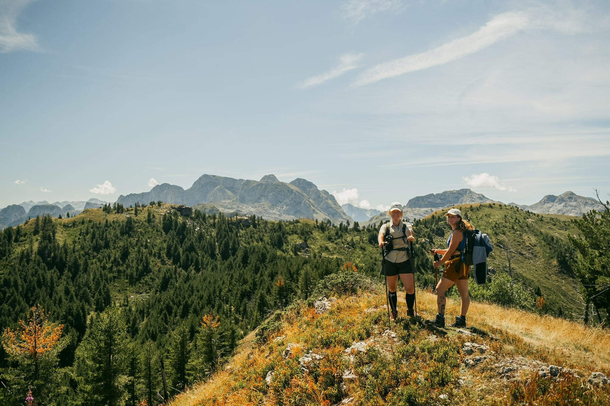
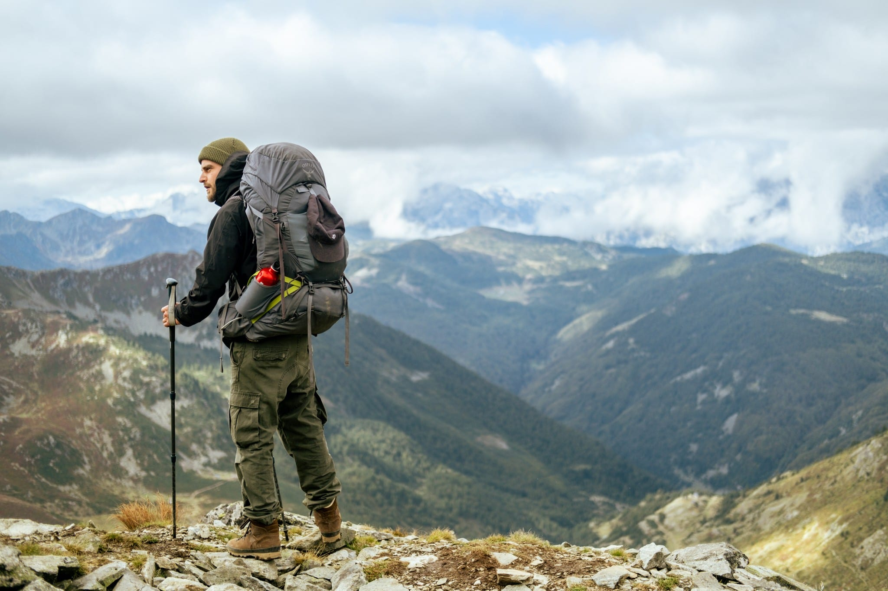
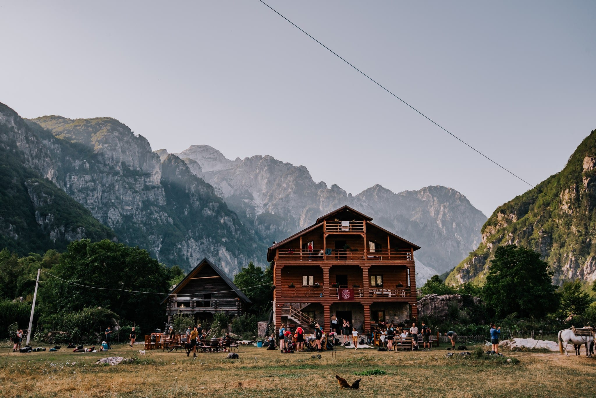

L’automne est la saison calme sur les Peaks of the Balkans. Les organisateurs de l’itinéraire recommandent la période de juin à octobre, et beaucoup de randonneurs considèrent septembre comme le meilleur mois. Octobre reste faisable, mais vous échangez la foule contre des jours plus courts, des nuits plus froides et un vrai risque de neige précoce sur les cols. Voici ce qui change entre ces deux mois, et comment vous organiser.

## Septembre et octobre en un coup d’œil

| | Septembre | Octobre |
|---|---|---|
| Météo | Plutôt stable, plus frais qu’en été, davantage de pluie et d’orages en fin de mois | Épisodes de pluie plus fréquents, nuits froides ; premières neiges possibles sur les cols |
| Températures | Journées agréables ; la nuit, en altitude, il peut geler | Dans les vallées, encore environ 20–25 °C par beau temps ; en altitude, bien plus froid |
| Lumière du jour | Environ 13 heures en début de mois, un peu moins de 12 en fin de mois | Environ 11 h 30 en début de mois, environ 10 h 30 en fin de mois ; nuit vers 17 h après le passage à l’heure d’hiver |
| Hébergements | Pratiquement tous encore ouverts | Beaucoup ouverts la première quinzaine ; cabanes et cafés saisonniers ferment |
| Fréquentation | Nettement moins de monde qu’en juillet et août | Très calme, souvent le sentier pour vous seul |
| Verdict | Excellent | Possible, idéalement début octobre et avec un plan flexible |

Les températures et la durée du jour sont approximatives et varient beaucoup d’une année à l’autre. Pour toute l’année, consultez [la meilleure période pour randonner sur les Peaks of the Balkans](/fr/best-time-peaks-of-the-balkans/).

## Septembre : le mois idéal

En septembre, la chaleur de juillet et d’août est passée, la foule estivale sur l’étape Theth – Valbonë s’est dispersée et toutes les maisons d’hôtes sont encore ouvertes. Les organisateurs locaux expérimentés le décrivent comme un mois moins fréquenté, où la nature commence à changer : moins de fleurs, plus de couleurs. La vue est souvent plus dégagée que pendant les mois brumeux de l’été.

Il y a aussi des inconvénients. Les jours raccourcissent nettement au fil du mois, le risque de pluie et d’orage augmente et, la nuit, il peut geler dans les villages et cabanes d’altitude ; certaines maisons d’hôtes allument déjà le chauffage. Prévoyez les longues étapes avec une marge de lumière et emportez une couche chaude pour les soirées. L’eau est aussi plus rare en automne : sources, ruisseaux et cascades comme celle de Grunas à Theth ont bien moins de débit qu’au début de l’été.

## Octobre : sentiers calmes, jours courts, premières neiges

Octobre est le dernier mois où l’on peut parcourir la boucle complète, et pas chaque année. Vous profitez de sentiers déserts, des couleurs d’automne dans les hêtraies et, par beau temps, d’une vue nette et fraîche. Une voyageuse partie dans le nord de l’Albanie en octobre a relevé jusqu’à environ 25 °C l’après-midi dans les vallées, autour de 10 °C le matin et le soir, et aucune foule nulle part.

Ce même voyage montre aussi le risque : la neige est tombée sur les montagnes dans les premiers jours d’octobre, à la surprise même des habitants, et la traversée du col de Valbona a dû être reportée. Des organisateurs signalent aussi des randonnées d’octobre annulées après plusieurs jours de fortes pluies d’affilée. Fin octobre, le soleil se lève vers 7 h et se couche avant 18 h : sur une longue étape, la marge en cas de retard est faible. Dans les centres touristiques, restaurants et cafés ferment ou réduisent leurs horaires.

## Hébergements, cabanes et repas en automne

L’itinéraire repose sur des maisons d’hôtes familiales et des cabanes saisonnières, et c’est ce qui limite le plus la randonnée en automne. Dans les villages (Theth, Valbonë, Plav, Vusanje, Rugova), beaucoup de maisons d’hôtes restent ouvertes jusqu’en octobre ou plus tard. Les hameaux d’estive en altitude, c’est une autre histoire : des lieux comme Dobërdol sont de petits hameaux de bergers avec très peu de lits, qui ferment quand les bergers quittent la montagne. Consultez [à quoi ressemble Dobërdol et où y dormir](/fr/dobrdol-plateau/) pour en savoir plus sur les cabanes du plateau.

Il n’existe pas de liste officielle des dates de fermeture : fin septembre et en octobre, appelez ou écrivez à chaque maison d’hôtes quelques jours à l’avance, même si vous avez réservé plus tôt. Demandez si elles servent encore le dîner et peuvent préparer un pique-nique, car les petits cafés du parcours sont souvent déjà fermés ; sur l’étape Theth – Valbonë en octobre, il arrive qu’une seule des haltes habituelles soit ouverte. Les transports publics se raréfient aussi après l’été, vérifiez donc sur place les horaires des minibus et du ferry.

## Le col de Valbona et la neige précoce

Les étapes les plus hautes et les plus exposées, dont la traversée entre Theth et Valbonë par le col de Valbona (environ 1 800 m) et les cols autour de Dobërdol et de la Gjeravica, sont les premières touchées par la neige. Les guides locaux préviennent que le col de Valbona devient dangereux après une chute de neige précoce, possible dès la fin septembre. Une fine couche de neige masque le sentier et rend les descentes raides glissantes.

S’il neige, attendez un jour ou deux, contournez le col en transfert ou remplacez l’étape par une randonnée plus basse. Ne franchissez jamais un col enneigé sans l’équipement et l’expérience nécessaires. Consultez [la randonnée de Theth à Valbonë](/fr/theth-to-valbona/) pour l’itinéraire lui-même.

## Conseils pour un voyage en automne

- **Partez tôt dans la saison :** la première quinzaine de septembre est le choix le plus sûr ; en octobre, partez le plus tôt possible dans le mois.
- **Démarrez aux premières lueurs :** planifiez chaque étape pour arriver bien avant la nuit, avec une heure de réserve.
- **Prévoyez le froid :** une polaire chaude ou une doudoune légère, un bonnet, des gants et une vraie veste de pluie. Consultez [la liste de matériel](/fr/peaks-of-the-balkans-packing-list/).
- **Appelez à l’avance :** confirmez chaque lit, dîner et pique-nique quelques jours avant votre arrivée.
- **Gardez un jour de réserve :** il vous permet d’attendre la fin d’un épisode de pluie ou la fonte de la neige sur un col.
- **Consultez la météo chaque soir** et interrogez vos hôtes sur l’étape suivante ; ce sont eux qui connaissent le mieux les cols.

Si vous préférez ne pas jongler avec les réservations et les transferts en intersaison, [The Balkan Trail](https://thebalkantrail.com) s’occupe des permis et des transferts, pour que vous marchiez à votre rythme avec des guides le long du parcours, avec transport de bagages et location de matériel en option.

## Sources

[Peaks of the Balkans – site officiel, conseils de voyage](https://peaksofthebalkans.com/Travel-Advice), [Peaks of the Balkans Info – quand partir](https://peaksofthebalkans.info/?p=533), [BN Adventure – guide complet des Peaks of the Balkans](https://bnadventure.com/peaks-of-the-balkans-trail-comprehensive-guide/), [Shipped Away – l’automne en Albanie](https://shippedaway.com/autumn-in-albania/), [Brooke Beyond – hébergements sur les Peaks of the Balkans](https://brookebeyond.com/pob-guesthouses).
