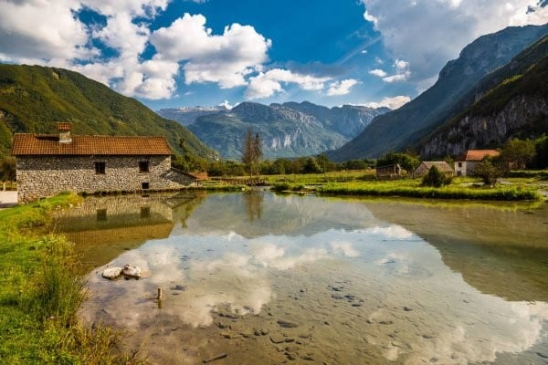
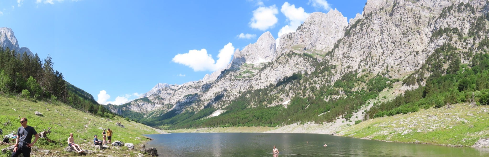
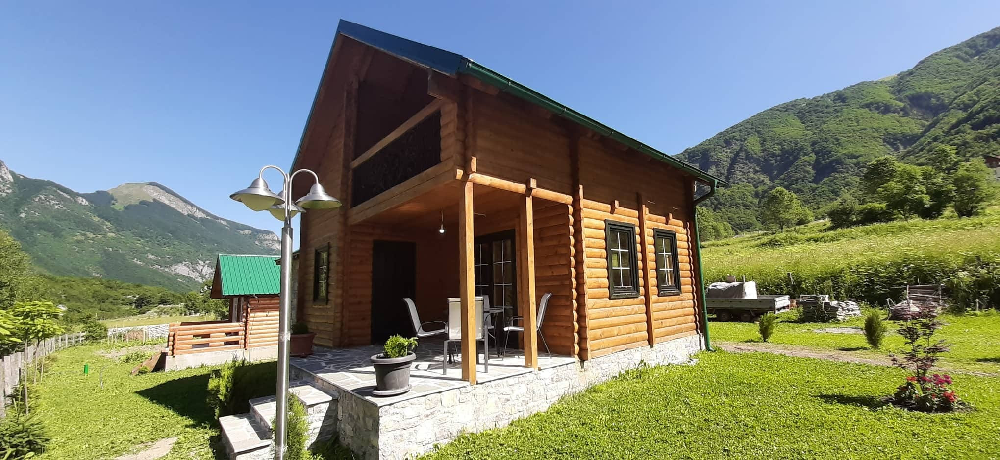

Vusanje, Vuthaj en albanais, se trouve tout au bout de la route dans les montagnes du Prokletije, au Monténégro, à quelques kilomètres après la petite ville de Gusinje. Derrière le village, la vallée de Ropojana file vers le sud entre d'immenses parois calcaires, en direction de la frontière albanaise. Pour les randonneurs des Peaks of the Balkans, c'est la dernière nuit au Monténégro avant le passage vers Theth, et il vaut la peine d'arriver tôt : les plus beaux sites sont à une courte balade de votre maison d'hôtes.

## Vusanje, Grlja et Ropojana en bref

| Site | De quoi s'agit-il | Depuis Vusanje | Meilleure période |
|---|---|---|---|
| Cascade de Grlja | rivière qui plonge dans un profond trou de roche | environ 300 m derrière le village | printemps et début d'été, quand il y a plus d'eau |
| Oko Skakavica | source karstique turquoise d'environ 30 m de large | environ 2,5 km plus haut que la cascade | tout l'été |
| Vallée de Ropojana | large vallée glaciaire sous des parois calcaires | commence au village | de juin à septembre |
| Lac de Ropojana | lac saisonnier à environ 1 240 m | plus loin dans la vallée, près de la zone frontalière | début d'été, avant qu'il ne rétrécisse |
| Sources d'Ali Pacha | grand bassin de source peu profond | à environ 1,4 km du centre de Gusinje | tout l'été |
| Qafa e Pejës | col sur l'étape vers Theth, environ 1 700 m | sur l'itinéraire des Peaks of the Balkans | de juillet à septembre |

Les distances et altitudes proviennent de descriptions d'itinéraires locales et varient un peu selon les sources : considérez-les comme approximatives.

## Vusanje : le village au bout de la route

Vusanje est un village agricole étendu, fait de maisons en pierre et en bois, de prairies et de meules de foin, avec les parois calcaires de la vallée de Ropojana en toile de fond. La route depuis Gusinje fait environ 5 km ; l'asphalte s'arrête à un pont juste après le village et se poursuit en piste de gravier dans la vallée. C'est un endroit calme ; la plupart des visiteurs sont des randonneurs, des cyclistes et des excursionnistes venus de Gusinje et de Plav.

Sur les Peaks of the Balkans, on arrive généralement ici depuis Plav, et on repart à pied le lendemain matin en remontant la vallée vers l'Albanie. Consultez [toutes les étapes jour par jour](/fr/peaks-of-the-balkans-stages/) pour voir où se situe Vusanje dans la boucle complète.

## Grlja : la cascade qui disparaît dans la roche

Juste derrière le village, à quelques centaines de mètres après le pont, un sentier traverse une prairie jusqu'à Grlja (aussi écrit Grla). Ici, la rivière Skakavica, qui descend de la vallée, tombe dans une immense marmite de pierre d'environ 20 m de profondeur et semble disparaître dans une grotte sombre ; les histoires locales la disent sans fond. L'eau ressort plus bas et continue sous le nom de rivière Grlja vers Gusinje.

Au printemps et au début de l'été, à la fonte des neiges, le grondement est impressionnant. Fin juillet, il peut y avoir peu d'eau, mais on l'entend toujours. Il n'y a pas de barrière autour du bord et les rochers sont humides : gardez les enfants près de vous et restez à distance du rebord.

## Oko Skakavica : la source en haut de la vallée

Environ 2,5 km plus haut dans la vallée, vers 1 000 m, la Skakavica naît à Oko Skakavice (« l'œil de la Skakavica », parfois appelé Savino Oko). C'est l'une des sources karstiques les plus abondantes du Prokletije : un bassin rond et turquoise d'environ 30 m de large, qui jaillit de plusieurs mètres de profondeur, avec une eau qui reste autour de 5 °C même en été. Un court sentier forestier balisé y mène depuis la piste de la vallée.

C'est une belle balade pour le soir de votre arrivée à Vusanje, ou une première pause sur l'étape vers Theth. La baignade est possible pour les courageux, mais l'eau est glaciale.

## La vallée de Ropojana et le lac de Ropojana

Au sud de la source, la vallée de Ropojana s'ouvre : une large vallée glaciaire plate, avec des hêtraies sur les pentes, des éboulis clairs et des parois calcaires grises de bien plus de 2 000 m de chaque côté. La piste de gravier suit le fond de la vallée et est souvent abîmée par les crues de printemps : attendez-vous à des passages difficiles. La partie monténégrine du parc national du Prokletije commence à un abri couvert en chemin.

Plus loin dans la vallée, à environ 15 minutes à travers la hêtraie depuis un embranchement balisé, se trouve le lac de Ropojana (Ropojansko jezero), à environ 1 240 m. Au début de l'été, il peut mesurer environ 700 m de long et jusqu'à 10 m de profondeur, mais il est alimenté par la fonte des neiges et rétrécit ou s'assèche souvent pendant les mois d'été. Le lac se trouve dans la zone frontalière : au-delà, la vallée continue en Albanie vers Zastan et les lacs de Bun i Jezercës. Sans permis frontaliers, le lac est l'endroit où faire demi-tour.

## Continuer : de Vusanje à Theth par Qafa e Pejës

Sur les Peaks of the Balkans, vous remontez la vallée de Ropojana dans la première partie de l'étape de Vusanje à Theth. Après la vallée, le sentier monte vers la frontière, marquée par une borne pyramidale de l'époque communiste, passe en Albanie et atteint Qafa e Pejës, le col de Peja, à environ 1 700 m, avant une longue descente raide vers la vallée de Theth.

| Vusanje → Theth | Chiffres (les sources diffèrent) |
|---|---|
| Distance | environ 21–23 km |
| Montée | environ 1 100–1 140 m |
| Descente | environ 1 140–1 440 m |
| Point culminant | environ 1 740 m |
| Temps de marche | environ 7 h 30 à 9 h |

C'est une longue journée : partez tôt et emportez assez d'eau pour la montée. Vous franchissez la frontière entre le Monténégro et l'Albanie hors de tout poste-frontière, il vous faut donc à l'avance les permis des deux pays ; voir [le guide des permis](/fr/peaks-of-the-balkans-permits/). Une fois en bas, [le guide de Theth](/fr/theth-guide/) vous dit quoi faire sur place.

## Où dormir et manger

Vusanje compte une poignée de maisons d'hôtes familiales, de chalets en bois et de campings, certains tout près de la cascade de Grlja. La plupart proposent la demi-pension avec un dîner et un petit-déjeuner faits maison, et peuvent préparer un panier-repas pour la journée vers Theth. Les prix sont à peu près dans la moyenne du reste du sentier ; voir [où dormir sur les Peaks of the Balkans](/fr/peaks-of-the-balkans-accommodation/) pour les tarifs habituels.

Réservez à l'avance pour juillet et août, quand les lits de Vusanje se remplissent vite. Gusinje, à environ 5 km, offre plus de choix, des commerces et des cafés. Les cartes sont rarement acceptées dans les maisons d'hôtes, alors arrivez avec suffisamment d'espèces ; Plav dispose de distributeurs.

## Conseils pratiques

- **Espèces :** on paie en euros. Prévoyez assez depuis Plav pour la maison d'hôtes et pour l'Albanie le lendemain.
- **Eau :** remplissez vos gourdes à la source d'Oko Skakavica ou demandez à votre maison d'hôtes ; il y a peu de sources fiables sur la montée vers Qafa e Pejës.
- **Sécurité à Grlja :** il n'y a pas de garde-corps à la cascade et le bord est glissant.
- **Zone frontalière :** ne dépassez pas le lac de Ropojana vers l'Albanie sans permis.
- **Orientation :** emportez une carte hors ligne ou une trace GPX. Le balisage est rouge et blanc, mais les passages en forêt et en alpage peuvent prêter à confusion dans le brouillard.

Si vous préférez ne pas organiser vous-même les permis, les maisons d'hôtes et les transferts, [The Balkan Trail](https://thebalkantrail.com) s'en charge, pour que vous marchiez à votre rythme avec des guides le long du parcours, avec en option le transport des bagages et la location de matériel.

## Sources

[Accursed Mountains – GU03 Ropojana Valley](https://accursed-mountains.me/?p=3948), [Accursed Mountains – GU04 Ali Pasha's Springs](https://accursed-mountains.me/?p=3950), [Peaks of the Balkans Info – Vusanje to Theth](https://peaksofthebalkans.info/?p=1826), [Peaks of the Balkans Info – Vusanje–Theth route description](https://peaksofthebalkans.info/?p=290), [Peaks of the Balkans Info – Vuthaj, Zastan and Bun i Jezercës](https://peaksofthebalkans.info/trail/stage/), [Gigaplaces – Oko Skakavice](https://www.gigaplaces.com/en/article-oko-skakavice/), [Shoes Your Path – Peaks of the Balkans from Vusanje to Theth](https://shoesyourpath.com/peaks-of-the-balkans-from-vusanje-to-theth/), [Peaks of the Balkans – official site](https://peaksofthebalkans.com/).
