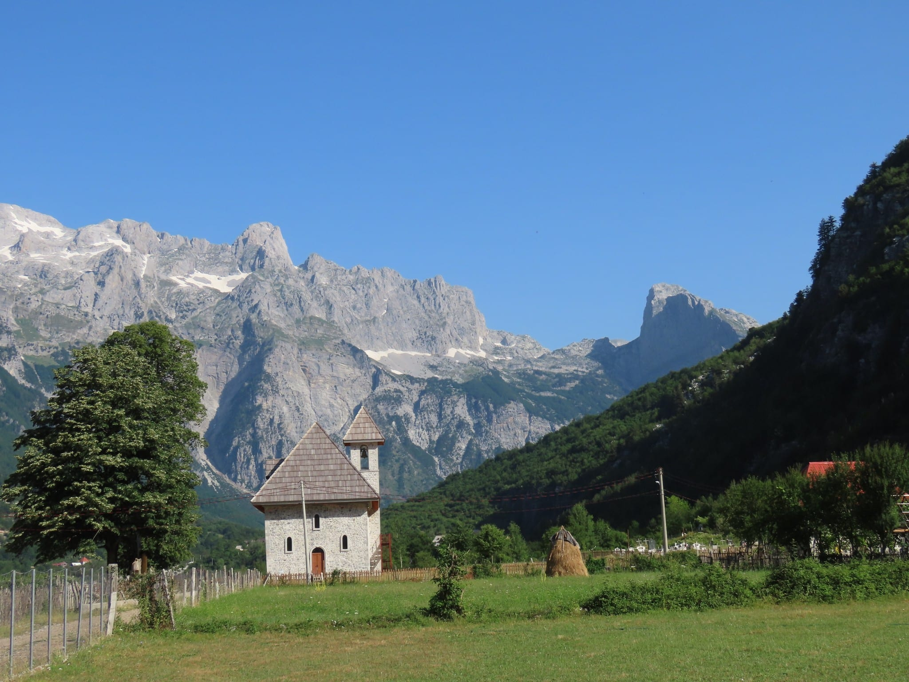
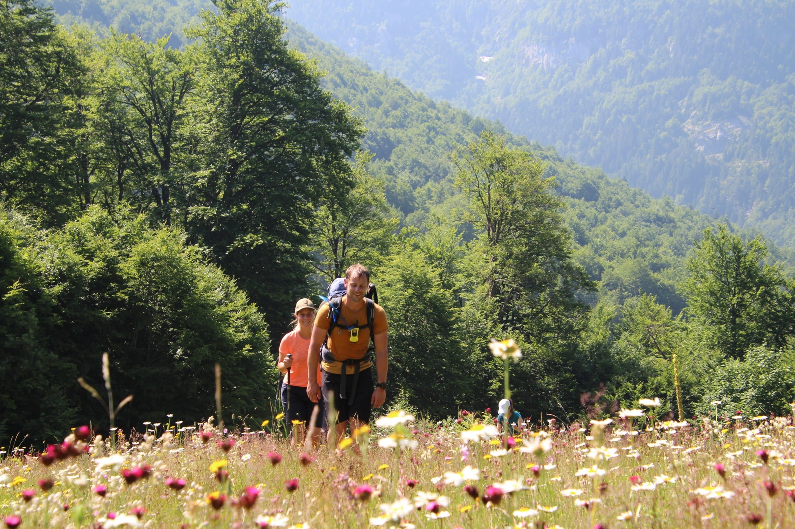
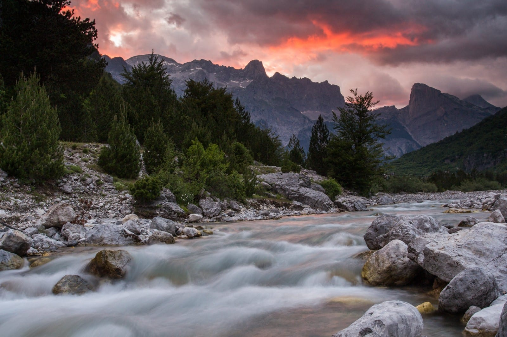

Juni is het begin van het seizoen op de Peaks of the Balkans. De dagen zijn de langste van het jaar, de valleien zijn groen en het is nog rustig op het pad. Het addertje onder het gras is sneeuw: in de Vervloekte Bergen valt in de winter veel sneeuw, en op de hoge passen kan die tot ver in juni blijven liggen. Of juni voor jou werkt, hangt af van het jaar, van welke helft van de maand je kiest en van je ervaring op sneeuw.

## Begin juni vs eind juni in één oogopslag

| | Begin juni | Eind juni |
|---|---|---|
| Sneeuw op hoge passen | Waarschijnlijk, soms veel; steile, harde sneeuwvelden op noordhellingen | Meestal alleen plekken; meer in sneeuwrijke jaren |
| Theth – Valbonë | Zomerpad kan na een sneeuwrijke winter nog dicht zijn; winterroute als alternatief | Normaal open |
| Weer | Meestal zacht; valleien ongeveer 20–25 °C, hoge passen koeler | Warmer; onweer in de namiddag komt vaker voor |
| Daglicht | Ongeveer 15 uur | Ongeveer 15 uur, de langste dagen van het jaar |
| Rivieren en bronnen | Hoog en snel door smeltwater | Nog volop water |
| Drukte | Heel rustig | Rustig, drukker richting juli |
| Oordeel | Alleen met sneeuwervaring, materiaal en een flexibel plan | In de meeste jaren goed |

Temperaturen en omstandigheden verschillen sterk van jaar tot jaar. Voor het hele seizoen, zie [de beste tijd om de Peaks of the Balkans te lopen](/nl/best-time-peaks-of-the-balkans/).

## Sneeuw: welke passen blijven het langst wit

Het grootste deel van de route loopt tussen ongeveer 1.700 en 2.300 m, en de sneeuw blijft het langst liggen op de steile noordkanten van de passen. Lokale organisaties noemen de oversteek tussen Vusanje en Theth (de Pejë-pas) en de Valbona-pas tussen Theth en Valbonë als plekken waar harde sneeuwvelden tot in juni blijven liggen; wandelaars vroeg in het seizoen moesten daar al omkeren. Hogere uitstapjes zoals de top van de Gjeravica en de route via Zla Kolata houden nog langer sneeuw vast.

2026 liet zien hoe groot het verschil kan zijn. Na een zware winter en een koude lente meldde een lokale organisatie op 27 mei 2026 sneeuw op bijna elke etappe, met het klassieke pad Theth – Valbonë nog dicht en de winterroute als enige veilige optie. Wandelaars die op 6 juni 2026 vertrokken, beschreven heel veel sneeuw op de hoge passen en toppen; zelfs sommige begeleide groepen sloegen hun geplande toppen over. In een normaal jaar is de sneeuw op de hoge passen tegen eind juni grotendeels weg.

Sneeuw op deze hellingen is geen rustige wandeling. Een dunne, harde laag verbergt het pad, en een uitglijder op een steil sneeuwveld kan tussen de rotsen eindigen. Microspikes en wandelstokken maken een groot verschil, maar vervangen geen ervaring op sneeuw. Heb je die niet, kies dan eind juni of wacht tot juli.

## De etappe Theth – Valbonë in juni

Dit is de bekendste en drukste dag van de route, en ook de dag die als laatste opengaat. Het zomerpad over de Valbona-pas (ongeveer 1.800 m) blijft dicht tot de sneeuw van de pas verdwenen is; tot dan nemen wandelaars een lagere winterroute of een transfer. Vraag de avond ervoor aan je gastenverblijf in Theth of Valbonë welke route in gebruik is. Zie [de wandeling van Theth naar Valbonë](/nl/theth-to-valbona/) voor de route zelf.

## Waarom juni toch de moeite waard is

Als de sneeuw het toelaat, is juni een van de mooiste maanden op het pad. De hoge weides zijn frisgroen en vol wilde bloemen, de watervallen staan op hun volst en de herders trekken naar de zomerweides. Je hebt ook de langste dagen van het jaar, en dus veel marge op lange etappes.

Het is ook veel rustiger dan in juli en augustus. Buiten Theth – Valbonë kun je uren lopen zonder iemand tegen te komen, en gastenverblijven hebben meestal plaats zonder dat je maanden vooruit moet boeken.

## Rivieren, water en weer

Door het smeltwater is juni een natte maand onder je voeten. Beken en rivieren staan hoog en stromen snel, sommige oversteken die in augustus makkelijk zijn vragen nu voorzichtigheid, en paden kunnen modderig zijn. Anderzijds stromen de bronnen en is water zelden een probleem, behalve op lange hoge stukken waar sneeuw soms het enige water is; neem op die dagen een extra fles mee.

Het weer is meestal aangenaam: wandelaars meldden in juni 2026 ongeveer 20–25 °C in de valleien en zo'n 10–18 °C op de passen, heldere ochtenden en meer bewolking in de namiddag. Op zomermiddagen bouwt zich onweer op boven de bergen, dus vertrek vroeg en zorg dat je elke pas begin van de middag over bent. Neem een warme laag mee voor winderige passen en koude vroege starts.

## Gastenverblijven en hutten in juni

In de grote dorpen (Theth, Valbonë, Plav, Vusanje) zijn de meeste gastenverblijven vanaf juni open. De hoge zomernederzettingen zijn meer seizoensgebonden: plekken als Dobërdol zijn herdersnederzettingen die tot leven komen als de kuddes naar boven trekken, en in een laat jaar gaan ze misschien later open of hebben ze minder bedden. Er bestaat geen officiële lijst met openingsdata, dus neem rechtstreeks contact op met elk gastenverblijf, zeker voor de eerste helft van juni. Zie [hoe Dobërdol is en waar je er slaapt](/nl/dobrdol-plateau/).

## Zo plan je een trip in juni

- **Kies liefst de tweede helft van juni,** zeker na een sneeuwrijke winter.
- **Check de omstandigheden een week voor vertrek:** vraag je gastenverblijven, lokale gidsen of organisaties naar elke pas, en opnieuw de avond voor elke hoge etappe.
- **Neem microspikes en wandelstokken mee,** en steek alleen steile sneeuw over als je weet hoe dat moet.
- **Heb een plan B** voor elke hoge pas: een lagere route, een transfer of een rustdag.
- **Gebruik een gps-track,** want sneeuw bedekt markeringen en paden. Zie [de paklijst](/nl/peaks-of-the-balkans-packing-list/) voor de rest van je uitrusting.
- **Regel je vergunningen op tijd:** grensvergunningen heb je in elk seizoen nodig. Zie [de gids over vergunningen](/nl/peaks-of-the-balkans-permits/).

Laat je het checken van passen en bedden liever aan iemand anders over? [The Balkan Trail](https://thebalkantrail.com) regelt vergunningen en transfers, zodat je op je eigen tempo loopt met gidsen langs de route, met optioneel bagagevervoer en materiaalverhuur.

## Bronnen

[Peaks of the Balkans – officiële site](https://peaksofthebalkans.com/), [BN Adventure – update over de omstandigheden, eind mei 2026](https://bnadventure.com/pob-trail-conditions-may-2026/), [Peaks of the Balkans App – wanneer is de beste tijd om te wandelen](https://peaksofthebalkans.app/articles/when-is-the-best-time-to-hike), [Brooke Beyond – route- en planningsgids Peaks of the Balkans](https://brookebeyond.com/peaks-of-the-balkans), [Wander Balkans – is de Peaks of the Balkans veilig?](https://wanderbalkans.com/peaks-of-the-balkans-safety/).
