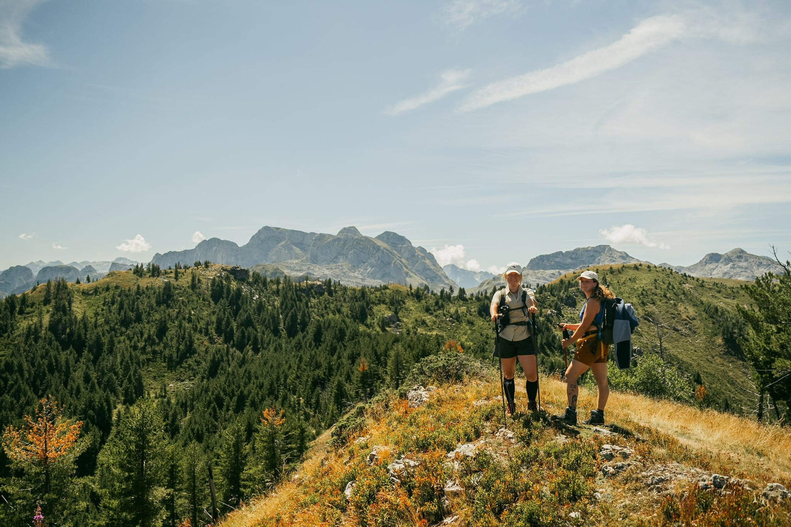
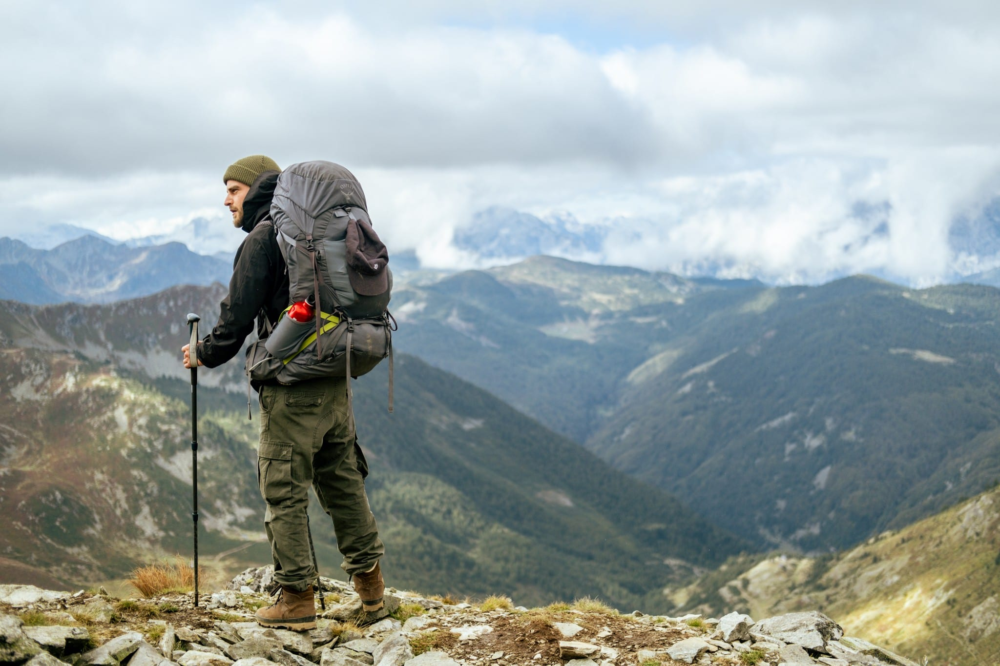
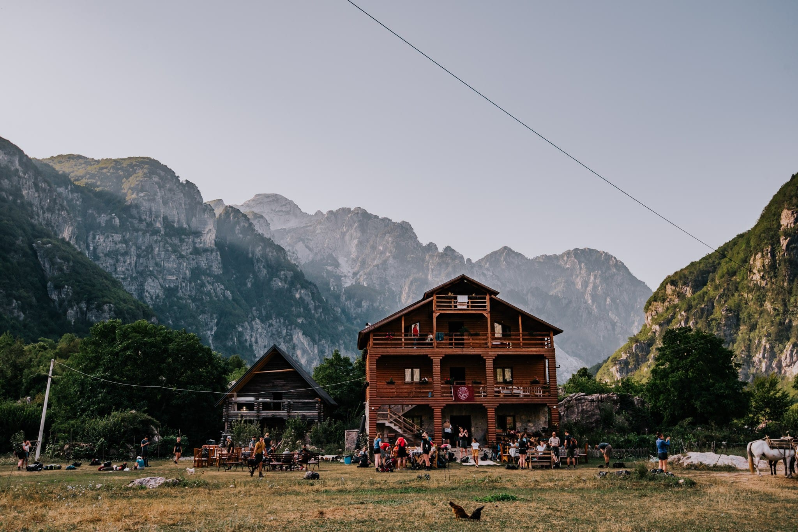

De herfst is het rustige seizoen op de Peaks of the Balkans. De organisatoren van de route raden juni tot oktober aan, en veel wandelaars vinden september de allerbeste maand. Oktober is nog te doen, maar je ruilt de drukte in voor kortere dagen, koudere nachten en een reële kans op vroege sneeuw op de passen. Dit is wat er verandert tussen de twee maanden, en hoe je daar rekening mee houdt.

## September en oktober in één oogopslag

| | September | Oktober |
|---|---|---|
| Weer | Meestal stabiel, koeler dan in de zomer, meer regen en onweer tegen het einde van de maand | Vaker regenperiodes, koude nachten; eerste sneeuw op de passen is mogelijk |
| Temperaturen | Aangename dagen; 's nachts kan het in de hoogte onder 0 °C zakken | In de dalen op zonnige dagen nog zo'n 20–25 °C; hoger is het veel kouder |
| Daglicht | Zo'n 13 uur aan het begin, net onder 12 aan het einde | Zo'n 11,5 uur aan het begin, zo'n 10,5 aan het einde; donker rond 17:00 zodra de klok terug is gezet |
| Gastenverblijven | Vrijwel allemaal nog open | Veel open in de eerste helft; seizoenshutten en cafés sluiten |
| Drukte | Duidelijk minder mensen dan in juli en augustus | Heel rustig, vaak heb je het pad voor jezelf |
| Oordeel | Uitstekend | Mogelijk, het best begin oktober en met een flexibel plan |

Temperaturen en daglicht zijn bij benadering en verschillen sterk van jaar tot jaar. Voor het hele jaar, zie [de beste tijd om de Peaks of the Balkans te wandelen](/nl/best-time-peaks-of-the-balkans/).

## September: het ideale moment

In september is de hitte van juli en augustus voorbij, is de zomerdrukte op de etappe Theth – Valbonë afgenomen en zijn alle gastenverblijven nog open. Lokale organisatoren met jarenlange ervaring beschrijven het als minder druk, met een natuur die begint te kleuren: minder bloemen, meer kleur. Het uitzicht is vaak helderder dan in de heiige zomermaanden.

Er zijn ook nadelen. De dagen worden in de loop van de maand merkbaar korter, de kans op regen en onweer neemt toe en 's nachts kan het in de hoge dorpen en hutten vriezen; sommige gastenverblijven zetten de verwarming al aan. Plan lange etappes met een marge aan daglicht en neem een warme laag mee voor de avonden. Er is in de herfst ook minder water: bronnen, beken en watervallen zoals Grunas in Theth voeren veel minder water dan in de vroege zomer.

## Oktober: stille paden, kortere dagen, eerste sneeuw

Oktober is de laatste maand waarin je de volledige lus kunt lopen, en zelfs dan niet elk jaar. Je krijgt lege paden, herfstkleuren in de beukenbossen en op een goede dag een frisse, heldere blik. Een wandelaar die in oktober Noord-Albanië bezocht, meldde overdag tot zo'n 25 °C in de dalen, rond 10 °C 's ochtends en 's avonds, en nergens drukte.

Diezelfde reis laat ook het risico zien: in de eerste dagen van oktober viel er sneeuw op de bergen, onverwacht zelfs voor de lokale bevolking, en de tocht over de Valbona-pas moest worden uitgesteld. Organisatoren melden ook dat oktobertochten werden geannuleerd na meerdere dagen zware regen op rij. Eind oktober komt de zon rond 7:00 op en gaat ze voor 18:00 onder, dus bij een lange etappe heb je weinig ruimte voor vertraging. Restaurants en cafés in de toeristische centra gaan dicht of korten hun openingsuren in.

## Gastenverblijven, hutten en eten in de herfst

De route draait op familiegastenverblijven en seizoenshutten, en dat is wat wandelen in de herfst het meest beperkt. In de dorpen (Theth, Valbonë, Plav, Vusanje, Rugova) blijven veel gastenverblijven open tot in oktober of langer. De hoge zomernederzettingen zijn een ander verhaal: plekken als Dobërdol zijn kleine herdersnederzettingen met heel weinig bedden, en ze sluiten zodra de herders de bergen verlaten. Zie [hoe Dobërdol is en waar je er slaapt](/nl/dobrdol-plateau/) voor meer over de hutten op de hoogvlakte.

Er bestaat geen officiële lijst met sluitingsdata, dus bel of stuur eind september en in oktober elk gastenverblijf een paar dagen vooraf een bericht, ook als je eerder hebt geboekt. Vraag of ze nog avondeten serveren en een lunchpakket kunnen maken, want de kleine cafés onderweg zijn vaak al dicht; op de etappe Theth – Valbonë is in oktober soms maar één van de gebruikelijke stopplaatsen open. Ook het openbaar vervoer wordt na de zomer dunner, dus check de tijden van minibusjes en veerboot ter plaatse.

## De Valbona-pas en vroege sneeuw

De hoogste en meest blootgestelde etappes, waaronder de oversteek tussen Theth en Valbonë over de Valbona-pas (zo'n 1.800 m) en de hoge passen rond Dobërdol en Gjeravica, krijgen als eerste met sneeuw te maken. Lokale gidsen waarschuwen dat de Valbona-pas gevaarlijk wordt na vroege sneeuwval, die al vanaf eind september kan komen. Een dun laagje sneeuw verbergt het pad en maakt de steile afdalingen glad.

Valt er sneeuw, wacht dan een dag of twee, neem een transfer om de pas heen of ruil de etappe in voor een lagere wandeling. Steek nooit een besneeuwde pas over zonder de juiste uitrusting en ervaring. Zie [de wandeling van Theth naar Valbonë](/nl/theth-to-valbona/) voor de route zelf.

## Tips voor een herfsttocht

- **Ga vroeg:** de eerste helft van september is de veiligste keuze; ga in oktober zo vroeg mogelijk in de maand.
- **Vertrek bij het eerste licht:** plan elke etappe zo dat je ruim voor donker aankomt, met een uur reserve.
- **Pak in voor kou:** een warme fleece of lichte donsjas, muts, handschoenen en een goede regenjas. Zie [de paklijst](/nl/peaks-of-the-balkans-packing-list/).
- **Bel vooraf:** bevestig elk bed, avondeten en lunchpakket een paar dagen voor je aankomt.
- **Plan een reservedag:** zo kun je een regenperiode uitzitten of wachten tot de sneeuw van een pas is gesmolten.
- **Check elke avond de weersverwachting** en vraag je gastheer naar de volgende etappe; zij kennen de passen het best.

Wil je in het tussenseizoen liever niet zelf met boekingen en transfers jongleren, dan regelt [The Balkan Trail](https://thebalkantrail.com) de vergunningen en transfers, zodat je op je eigen tempo loopt met gidsen langs de route, met optioneel bagagevervoer en materiaalverhuur.

## Bronnen

[Peaks of the Balkans – officiële site, reisadvies](https://peaksofthebalkans.com/Travel-Advice), [Peaks of the Balkans Info – wanneer gaan](https://peaksofthebalkans.info/?p=533), [BN Adventure – uitgebreide gids Peaks of the Balkans](https://bnadventure.com/peaks-of-the-balkans-trail-comprehensive-guide/), [Shipped Away – herfst in Albanië](https://shippedaway.com/autumn-in-albania/), [Brooke Beyond – gastenverblijven op de Peaks of the Balkans](https://brookebeyond.com/pob-guesthouses).
