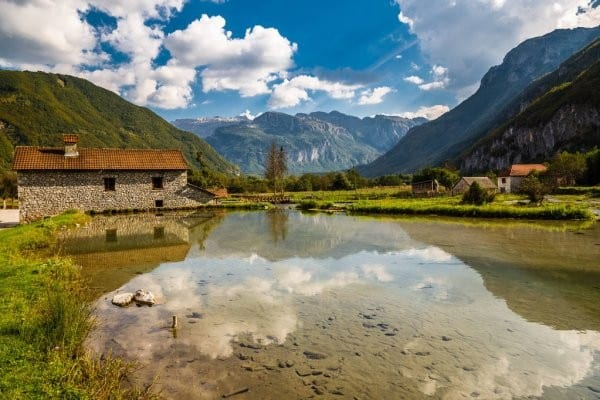
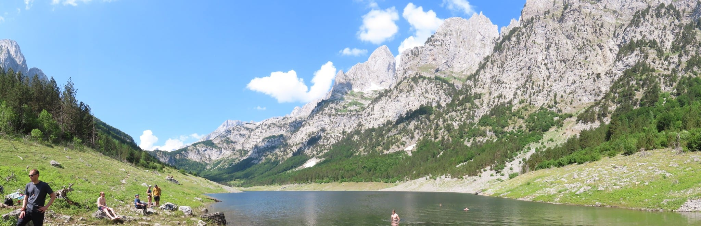
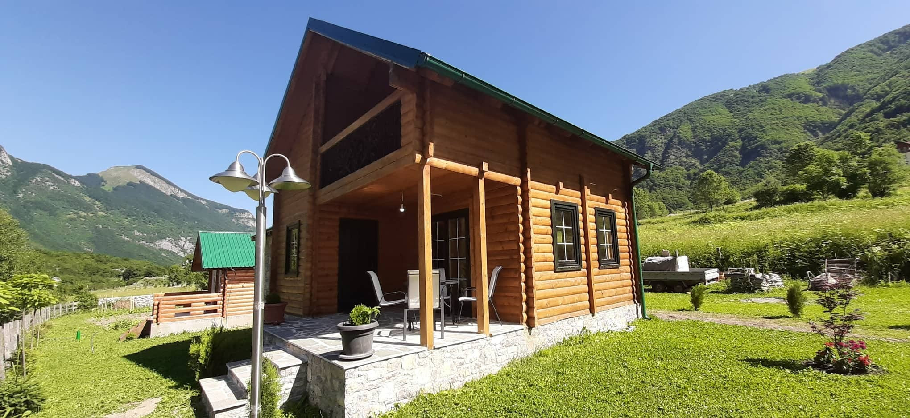

Vusanje, in het Albanees Vuthaj, ligt helemaal aan het eind van de weg in het Prokletije-gebergte van Montenegro, een paar kilometer voorbij het stadje Gusinje. Achter het dorp loopt het Ropojana-dal naar het zuiden, tussen enorme kalksteenwanden, richting de Albanese grens. Voor wandelaars op de Peaks of the Balkans is het de laatste nacht in Montenegro voor de oversteek naar Theth, en het loont om vroeg aan te komen: de mooiste plekken liggen op een makkelijke wandeling van je guesthouse.

## Vusanje, Grlja en Ropojana in het kort

| Bezienswaardigheid | Wat het is | Vanaf Vusanje | Beste tijd |
|---|---|---|---|
| Grlja-waterval | rivier die in een diep rotsgat stort | zo'n 300 m achter het dorp | lente en vroege zomer, als er meer water is |
| Oko Skakavica | turquoise karstbron, zo'n 30 m breed | zo'n 2,5 km het dal in vanaf de waterval | de hele zomer |
| Ropojana-dal | breed gletsjerdal onder kalksteenwanden | begint bij het dorp | juni tot september |
| Ropojana-meer | seizoensmeer op zo'n 1.240 m | dieper in het dal, bij de grenszone | vroege zomer, voor het krimpt |
| Bronnen van Ali Pasha | grote, ondiepe bronvijver | zo'n 1,4 km van het centrum van Gusinje | de hele zomer |
| Qafa e Pejës | pas op de etappe naar Theth, zo'n 1.700 m | op de route van de Peaks of the Balkans | juli tot september |

Afstanden en hoogtes komen uit lokale routebeschrijvingen en verschillen een beetje per bron, dus zie ze als richtwaarden.

## Vusanje: het dorp aan het eind van de weg

Vusanje is een uitgestrekt boerendorp met huizen van steen en hout, weides en hooibergen, met de kalksteenwanden van het Ropojana-dal erachter. De weg vanaf Gusinje is zo'n 5 km lang; het asfalt houdt op bij een brug net voorbij het dorp en gaat verder als grindweg het dal in. Het is een rustige plek; de meeste bezoekers zijn wandelaars, fietsers en dagjesmensen uit Gusinje en Plav.

Op de Peaks of the Balkans kom je hier meestal aan vanuit Plav, en de volgende ochtend vertrek je te voet het dal in richting Albanië. Bekijk [alle etappes dag per dag](/nl/peaks-of-the-balkans-stages/) om te zien hoe Vusanje in de hele lus past.

## Grlja: de waterval die in de rotsen verdwijnt

Vlak achter het dorp, een paar honderd meter voorbij de brug, loopt een pad door een weide naar Grlja (ook Grla geschreven). Hier valt de rivier Skakavica, die uit het dal komt, in een enorme stenen kuip van zo'n 20 m diep en lijkt te verdwijnen in een donkere grot; volgens lokale verhalen is die bodemloos. Verderop komt het water weer boven en stroomt als de rivier Grlja verder naar Gusinje.

In de lente en vroege zomer, als de sneeuw smelt, is het gebulder indrukwekkend. Eind juli kan er weinig water zijn, maar je hoort het nog steeds. Er staat geen hek rond de rand en de rotsen zijn nat, dus houd kinderen dicht bij je en blijf uit de buurt van de rand.

## Oko Skakavica: de bron bovenin het dal

Zo'n 2,5 km verder het dal in, op ongeveer 1.000 m, ontspringt de Skakavica bij Oko Skakavice ("het oog van de Skakavica", soms ook Savino Oko genoemd). Het is een van de rijkste karstbronnen van Prokletije: een ronde, turquoise vijver van zo'n 30 m breed, die van enkele meters diep opwelt, met water dat ook in de zomer rond de 5 °C blijft. Een kort, bewegwijzerd bospad leidt er vanaf de grindweg naartoe.

Het is een mooie avondwandeling op de dag dat je in Vusanje aankomt, of een eerste pauze op de etappe naar Theth. Zwemmen kan voor wie durft, maar het water is ijskoud.

## Het Ropojana-dal en het Ropojana-meer

Ten zuiden van de bron gaat het Ropojana-dal open: een breed, vlak gletsjerdal met beukenbos op de hellingen, lichte puinhellingen en grijze kalksteenwanden van ruim boven de 2.000 m aan beide kanten. De grindweg volgt de dalbodem en raakt vaak beschadigd door voorjaarsoverstromingen, dus reken op ruwe stukken. Het Montenegrijnse deel van het Nationaal Park Prokletije begint bij een overdekte rustplek onderweg.

Dieper in het dal, zo'n 15 minuten door beukenbos vanaf een bewegwijzerde splitsing, ligt het Ropojana-meer (Ropojansko jezero) op ongeveer 1.240 m. In de vroege zomer kan het zo'n 700 m lang en tot ongeveer 10 m diep zijn, maar het wordt gevoed door smeltwater en krimpt of valt in de zomermaanden vaak droog. Het meer ligt in de grenszone: daarna loopt het dal door naar Albanië, richting Zastan en de meren van Bun i Jezercës. Zonder grensvergunningen is het meer het punt om om te keren.

## Verder lopen: van Vusanje naar Theth over Qafa e Pejës

Op de Peaks of the Balkans loop je door het Ropojana-dal als eerste deel van de etappe van Vusanje naar Theth. Na het dal klimt het pad naar de grens bij een piramidevormige grenspaal uit de communistische tijd, steekt over naar Albanië en bereikt Qafa e Pejës, de Peja-pas op zo'n 1.700 m, voor een lange, steile afdaling naar het dal van Theth.

| Vusanje → Theth | Cijfers (bronnen verschillen) |
|---|---|
| Afstand | zo'n 21–23 km |
| Stijgen | zo'n 1.100–1.140 m |
| Dalen | zo'n 1.140–1.440 m |
| Hoogste punt | zo'n 1.740 m |
| Looptijd | zo'n 7,5–9 uur |

Het is een lange dag, dus vertrek vroeg en neem genoeg water mee voor de klim. Je steekt de grens tussen Montenegro en Albanië over buiten een grenspost, dus je hebt vooraf vergunningen voor beide landen nodig; zie [de gids over vergunningen](/nl/peaks-of-the-balkans-permits/). Ben je eenmaal beneden, dan lees je in [de gids over Theth](/nl/theth-guide/) wat je daar kunt doen.

## Slapen en eten

Vusanje heeft een handvol familieguesthouses, houten huisjes en campings, sommige vlak bij de Grlja-waterval. De meeste bieden halfpension met een zelfgekookt diner en ontbijt, en kunnen een lunchpakket maken voor de dag naar Theth. De prijzen liggen ongeveer in lijn met de rest van de route; zie [waar je slaapt op de Peaks of the Balkans](/nl/peaks-of-the-balkans-accommodation/) voor gangbare tarieven.

Boek vooruit voor juli en augustus, want de bedden in Vusanje raken dan snel vol. Gusinje, zo'n 5 km verderop, heeft meer keuze, winkels en cafés. In de guesthouses kun je zelden met je kaart betalen, dus kom met genoeg contant geld; in Plav zijn geldautomaten.

## Praktische tips

- **Contant geld:** je betaalt in euro. Neem genoeg mee uit Plav voor het guesthouse en voor Albanië de dag erna.
- **Water:** vul bij bij de bron Oko Skakavica of vraag het je guesthouse; op de klim naar Qafa e Pejës zijn weinig betrouwbare bronnen.
- **Veiligheid bij Grlja:** er staat geen reling bij de waterval en de rand is glad.
- **Grenszone:** loop zonder vergunningen niet voorbij het Ropojana-meer Albanië in.
- **Navigatie:** neem een offline kaart of GPX-track mee. De markering is rood-wit, maar de stukken door bos en weide kunnen bij mist verwarrend zijn.

Wil je liever niet zelf vergunningen, guesthouses en transfers regelen, dan regelt [The Balkan Trail](https://thebalkantrail.com) dat voor je, zodat je in je eigen tempo loopt met gidsen langs de route, met optioneel bagagevervoer en materiaalverhuur.

## Bronnen

[Accursed Mountains – GU03 Ropojana Valley](https://accursed-mountains.me/?p=3948), [Accursed Mountains – GU04 Ali Pasha's Springs](https://accursed-mountains.me/?p=3950), [Peaks of the Balkans Info – Vusanje to Theth](https://peaksofthebalkans.info/?p=1826), [Peaks of the Balkans Info – Vusanje–Theth route description](https://peaksofthebalkans.info/?p=290), [Peaks of the Balkans Info – Vuthaj, Zastan and Bun i Jezercës](https://peaksofthebalkans.info/trail/stage/), [Gigaplaces – Oko Skakavice](https://www.gigaplaces.com/en/article-oko-skakavice/), [Shoes Your Path – Peaks of the Balkans from Vusanje to Theth](https://shoesyourpath.com/peaks-of-the-balkans-from-vusanje-to-theth/), [Peaks of the Balkans – official site](https://peaksofthebalkans.com/).
